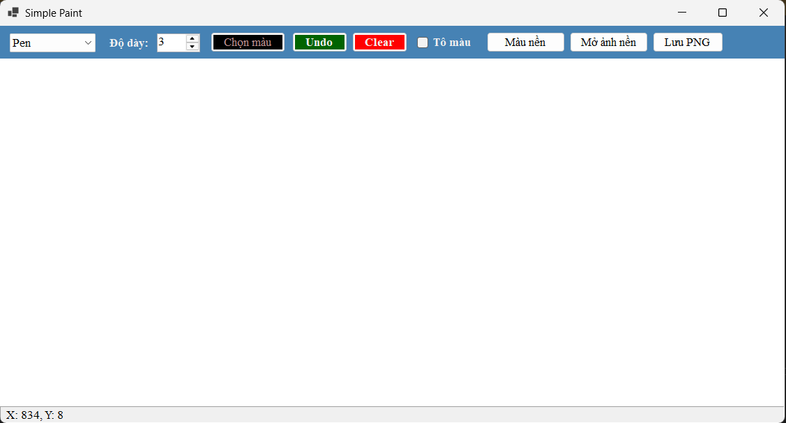
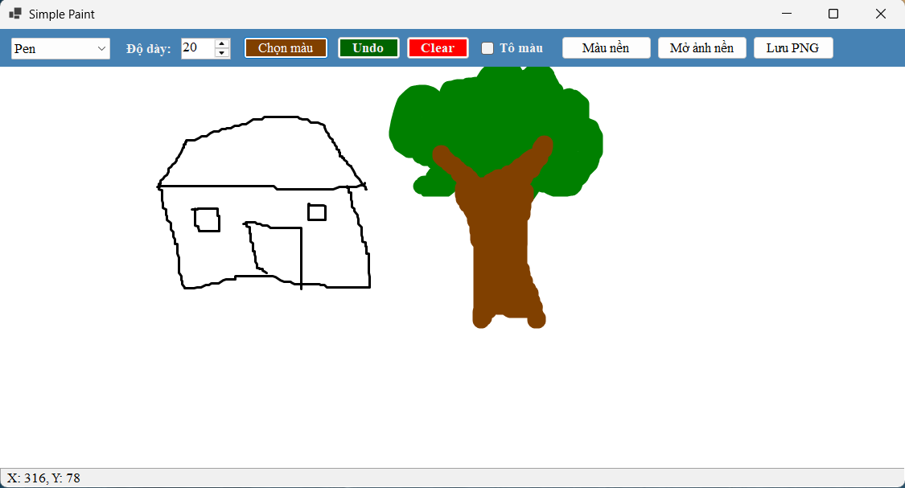
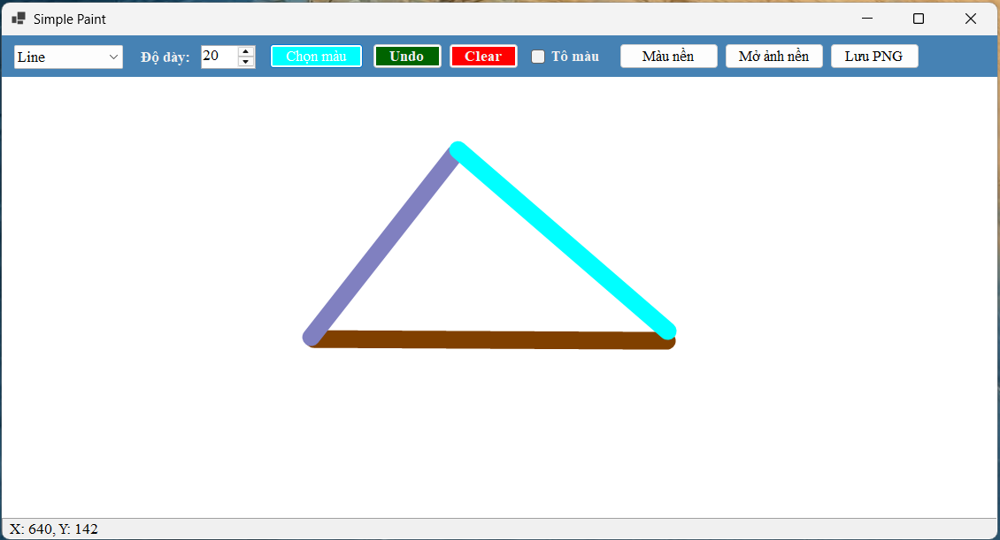
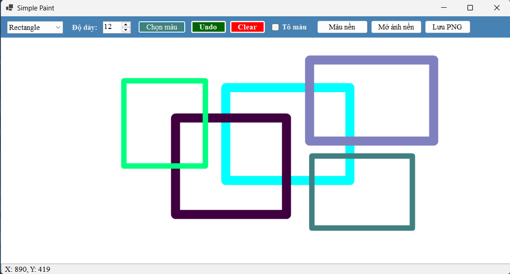
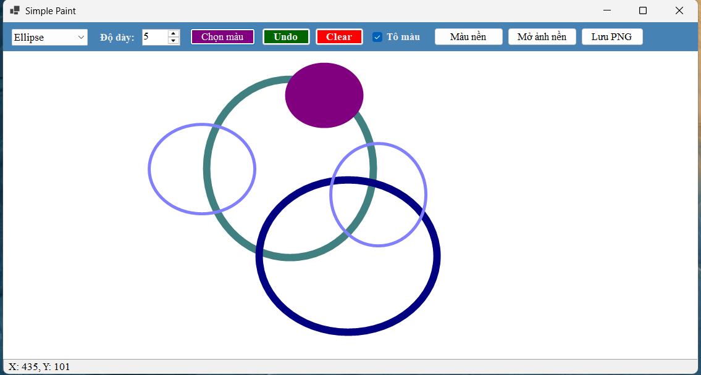
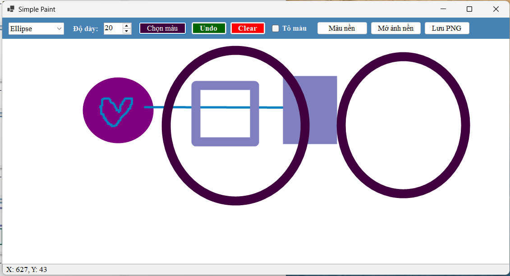
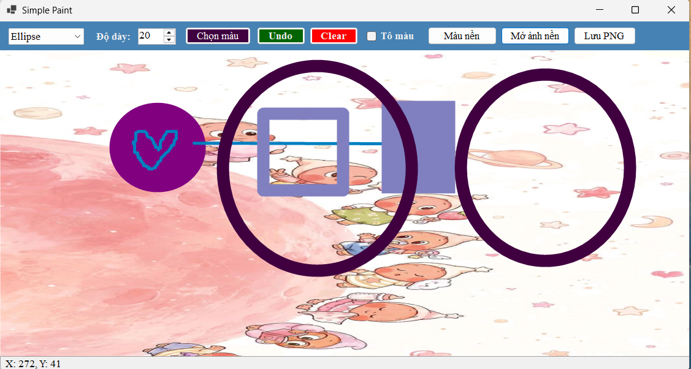

# Lab08 - Simple Paint

## Thông tin sinh viên
Họ tên: Võ Ngọc Tuyết Nhung
MSSV: 49.01.103.058
Lớp: 49.01.SPTIN.A

## Mô tả
Ứng dụng vẽ tương tác bằng chuột trên canvas. Các nét vẽ được lưu trong `List<DrawItem>` và vẽ lại trong sự kiện `Paint`, nên không bị mất khi resize hoặc khi cửa sổ bị che rồi hiện lại.

## Cách chạy chương trình

**Yêu cầu:** Windows 10/11, Visual Studio 2022 trở lên (workload *.NET desktop development*) và .NET 8 SDK.

**Cách 1: dùng Visual Studio**
1. Clone hoặc tải repo về máy.
2. Mở file `Lab08_Simplepaint.csproj` bằng Visual Studio.
3. Nhấn **F5** để chạy.

**Cách 2: dùng dòng lệnh**
```bash
cd Lab08_Simplepaint
dotnet run
```

> Nếu máy dùng phiên bản .NET khác, sửa `TargetFramework` trong file `.csproj` cho khớp (ví dụ `net10.0-windows`).

## Cách sử dụng

1. Chọn chế độ vẽ: **Pen**, **Line**, **Rectangle** hoặc **Ellipse**.
2. Chọn độ dày nét từ 1 đến 20.
3. Nhấn **Chọn màu** để mở hộp thoại chọn màu.
4. Nhấn giữ chuột trái trên canvas rồi kéo để vẽ. Với Line, Rectangle và Ellipse, hình co giãn theo chuột và được chốt khi thả chuột.
5. **Undo** (hoặc **Ctrl+Z**) xóa nét cuối cùng, **Clear** xóa toàn bộ.
6. Tọa độ chuột hiển thị ở thanh trạng thái phía dưới.

## Chức năng

**Bắt buộc:** vẽ Pen, Line, Rectangle, Ellipse (kéo theo mọi hướng); chọn màu bằng ColorDialog; chọn độ dày bằng NumericUpDown; Undo; Clear; hiển thị tọa độ chuột; nét vẽ không mất khi resize.

**Nâng cao:**

| Chức năng | Cách dùng |
|---|---|
| Lưu ra file PNG | Nút **Lưu PNG** |
| Mở ảnh nền để vẽ đè | Nút **Mở ảnh nền** |
| Phím tắt Ctrl+Z để Undo | Nhấn **Ctrl+Z** |
| Tô màu hình chữ nhật, ellipse | Tick ô **Tô màu** trước khi vẽ |
| Đổi màu nền canvas | Nút **Màu nền** |

## Kỹ thuật chính

- Vẽ trong sự kiện `Paint` của canvas, không vẽ trực tiếp trong `MouseMove`.
- Mỗi nét vẽ là một `DrawItem` trong `List<DrawItem>`; khi dữ liệu đổi thì gọi `canvas.Invalidate()`.
- `Pen` và `SolidBrush` được giải phóng bằng `using`.
- Hình chữ nhật và ellipse được chuẩn hóa bằng `Math.Min` / `Math.Abs` để kéo chuột theo mọi hướng đều đúng.
- Canvas là `DoubleBufferedPanel` để vẽ mượt, không nhấp nháy.
- Có `try/catch` khi mở và lưu ảnh, và kiểm tra giá trị chế độ vẽ.

## Ảnh chụp màn hình

**1. Giao diện khi mở ứng dụng**



**2. Vẽ tự do (Pen)**



**3. Vẽ đường thẳng (Line)**



**4. Vẽ hình chữ nhật (Rectangle), kéo theo nhiều hướng**



**5. Vẽ ellipse**



**6. Vẽ kết hợp nhiều loại hình**



**7. Chức năng nâng cao: mở ảnh nền và vẽ đè lên ảnh**



