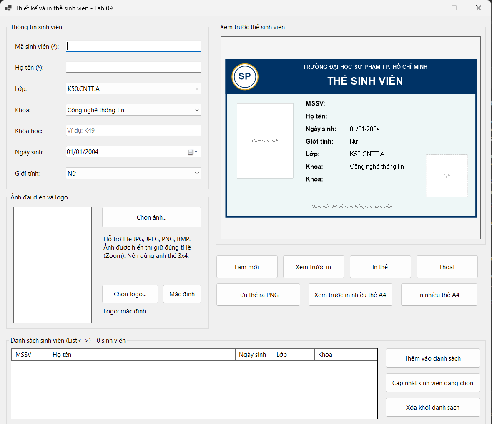
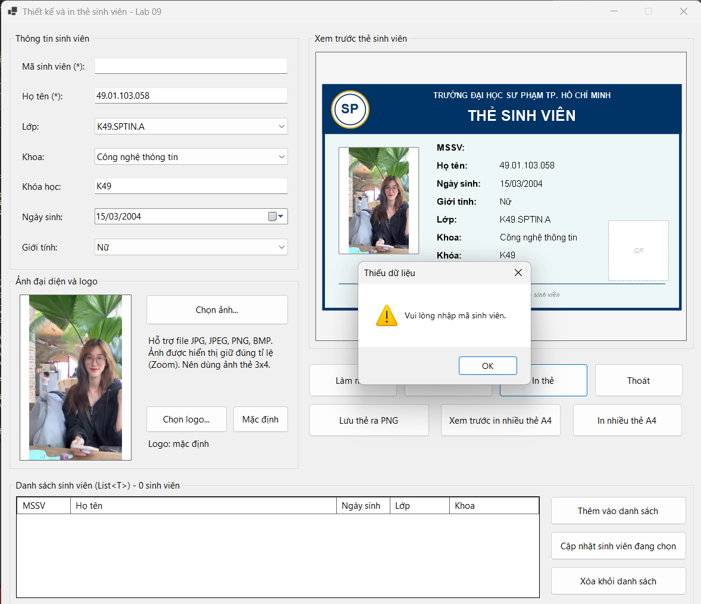
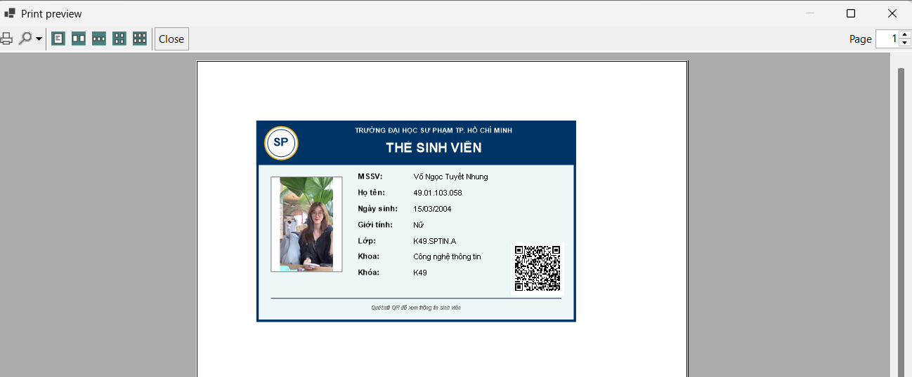
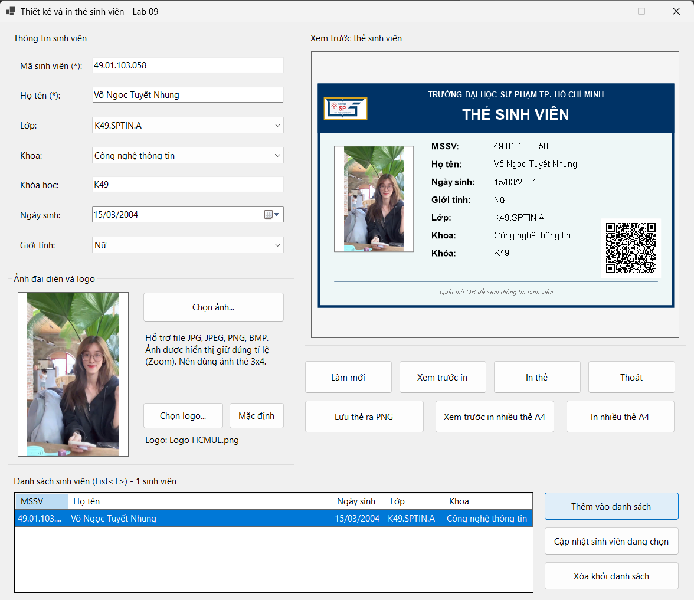
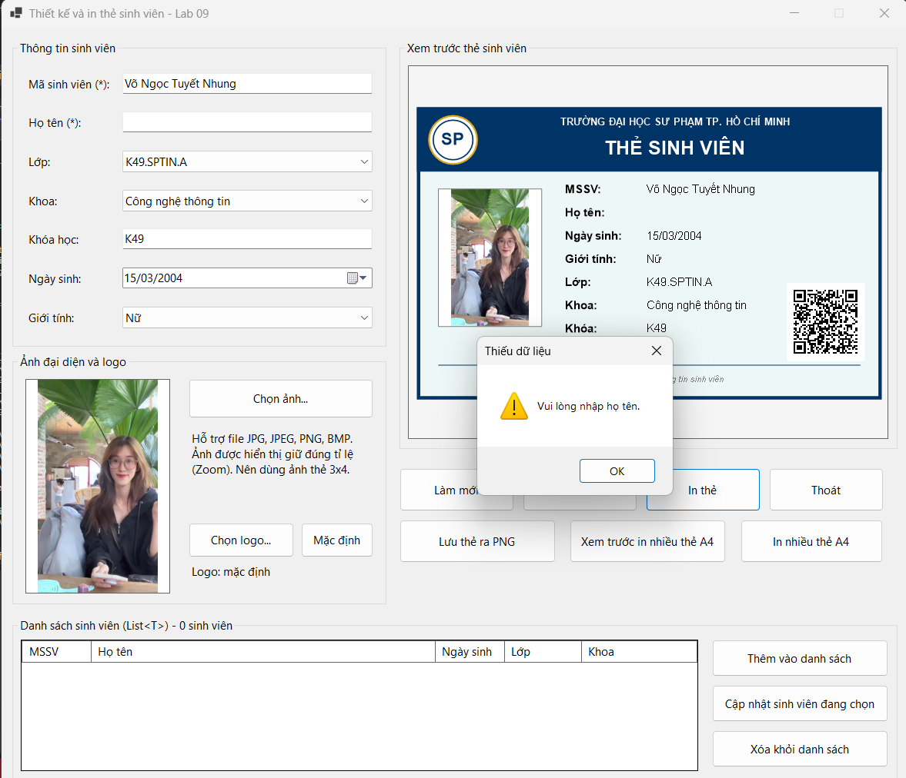
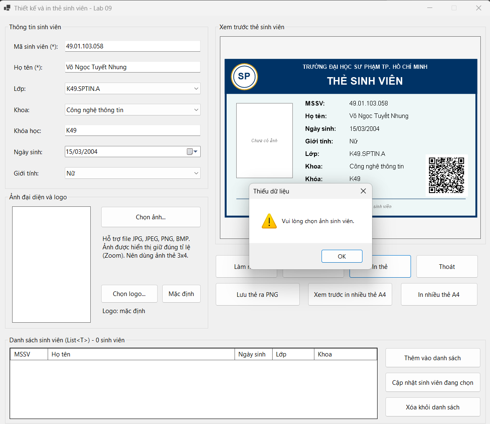
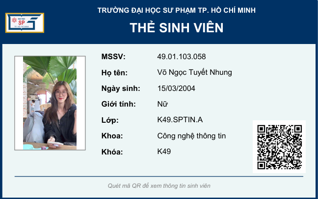
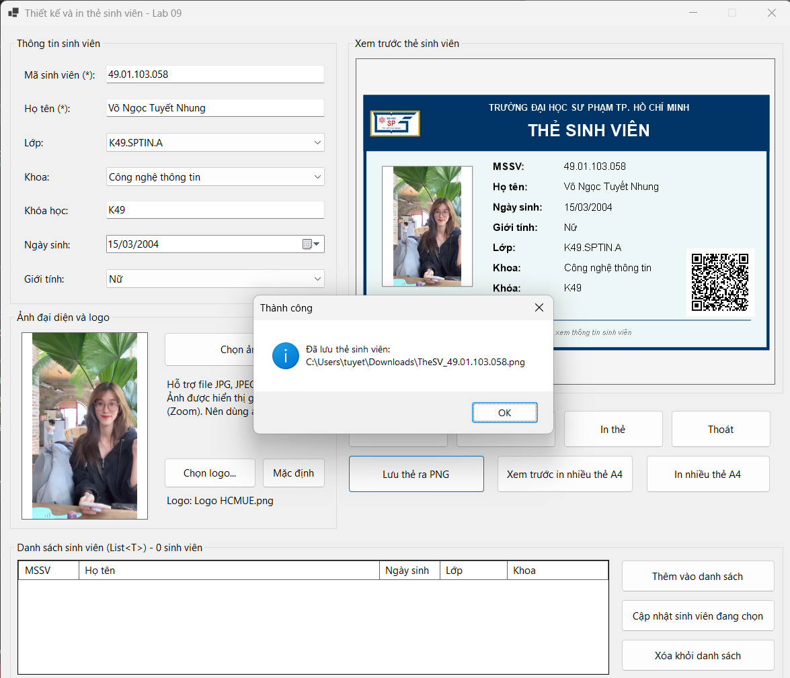
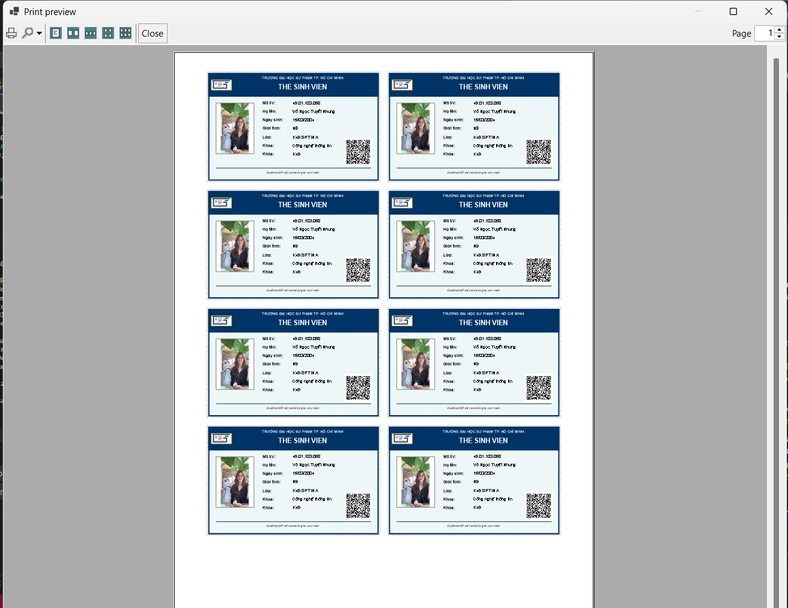
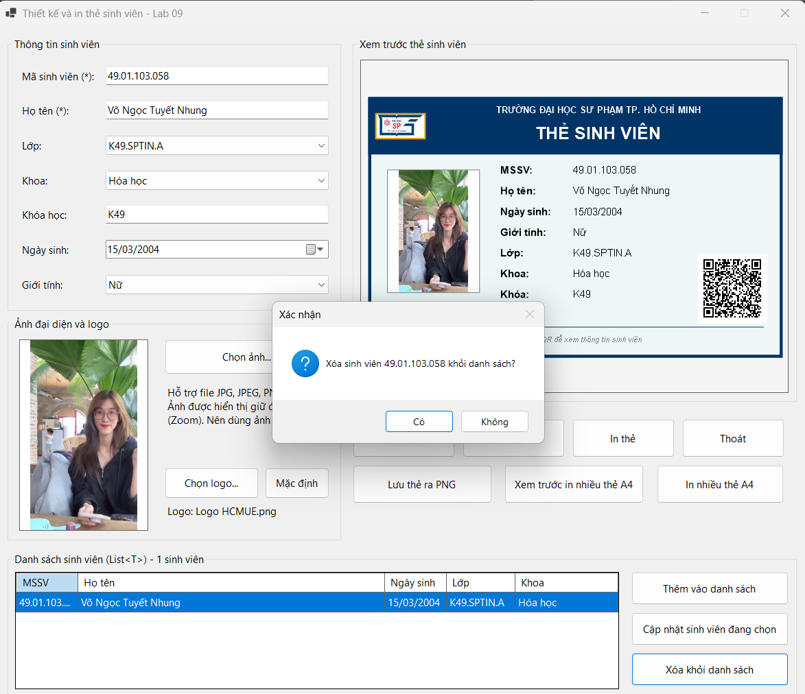

# Lab 09 – Thiết kế và in thẻ sinh viên bằng WinForms

## Thông tin sinh viên

- Họ tên: Võ Ngọc Tuyết Nhung
- MSSV: 49.01.103.058
- Lớp: 49.01.SPTIN.A

## Mô tả

Ứng dụng Windows Forms cho phép nhập thông tin sinh viên, chọn ảnh đại diện, **xem trước thẻ sinh viên theo thời gian thực** và **in thẻ** (hoặc xuất ra PDF/PNG). Thẻ được vẽ bằng **GDI+** trên `Panel`, sau đó dùng lại cho `PrintDocument` để bản in giống bản xem trước.

Ứng dụng **không dùng cơ sở dữ liệu**: dữ liệu nhập trực tiếp trên Form, danh sách sinh viên lưu tạm trong bộ nhớ bằng `List<T>`. Vì vậy repository không có script database và không có tài khoản demo.

## Công nghệ sử dụng

- C# – Windows Forms (.NET)
- Visual Studio 2022
- GDI+ (`Graphics`, sự kiện `Paint` của `Panel`)
- `PictureBox`, `OpenFileDialog`, `SaveFileDialog`
- `PrintDocument`, `PrintPreviewDialog`, `PrintDialog`
- `ListView`/`DataGridView` + `List<T>` cho danh sách sinh viên

## Chức năng

### Yêu cầu của đề bài

| Mã | Chức năng | Mô tả |
| --- | --- | --- |
| F1 | Chọn ảnh | `OpenFileDialog` lọc JPG, JPEG, PNG, BMP; ảnh hiển thị trong `PictureBox` chế độ **Zoom** (không méo); không khóa file ảnh cũ khi đổi ảnh. |
| F2 | Preview thẻ | Panel vẽ lại thẻ bằng GDI+ mỗi khi dữ liệu thay đổi. |
| F3 | Validation | Không cho xem trước/in nếu thiếu **mã sinh viên**, **họ tên** hoặc **ảnh**. |
| F4 | Print Preview | Nút **Xem trước in** mở `PrintPreviewDialog`. |
| F5 | Print | Nút **In thẻ** mở `PrintDialog` và in qua `PrintDocument`. |
| F6 | Làm mới | Xóa dữ liệu nhập, xóa ảnh, đưa Form về trạng thái ban đầu. |

### Chức năng mở rộng đã làm

- Mã **QR** giả lập trên thẻ.
- Chọn **logo** trường (nút *Chọn logo…*) hoặc quay về logo *Mặc định*.
- **Lưu thẻ ra PNG**.
- **Xem trước in / In nhiều thẻ trên một trang A4**.
- **Danh sách sinh viên** bằng `List<T>`: thêm, cập nhật, xóa (có xác nhận).

### Thông tin hiển thị trên thẻ

Mã sinh viên, họ tên, ngày sinh, giới tính, lớp, khoa, khóa học, ảnh đại diện, logo trường, tiêu đề **THẺ SINH VIÊN** và mã QR.

## Cách chạy

1. Mở file `.sln` ở thư mục gốc bằng Visual Studio.
2. Build Solution.
3. Nhấn **F5** (hoặc `Ctrl+F5`) để chạy project.

## Hình ảnh minh họa

### Form chính (trạng thái ban đầu)

**Chưa nhập mã sinh viên**

**Chưa nhập họ tên**

**Chưa chọn ảnh sinh viên**

### Xem trước khi in

## Test case

| STT | Chức năng | Các bước thực hiện | Kết quả mong đợi | Kết quả | Minh chứng |
| --- | --- | --- | --- | --- | --- |
| TC01 | Khởi động | Chạy chương trình | Hiển thị đủ nhóm nhập liệu, preview thẻ (ô ảnh “Chưa có ảnh”, QR trống), các nút và danh sách rỗng | Pass |  |
| TC02 | Chọn ảnh + preview thời gian thực | Nhập thông tin, bấm *Chọn ảnh…* và chọn ảnh | Ảnh hiển thị đúng tỉ lệ ở PictureBox; thẻ cập nhật ảnh và thông tin ngay | Pass |  |
| TC03 | Thiếu mã sinh viên | Để trống MSSV, bấm *In thẻ* | Báo “Vui lòng nhập mã sinh viên.”, không in | Pass |  |
| TC04 | Thiếu họ tên | Nhập MSSV, để trống họ tên, bấm *In thẻ* | Báo “Vui lòng nhập họ tên.”, không in | Pass |  |
| TC05 | Thiếu ảnh | Nhập đủ MSSV, họ tên, chưa chọn ảnh, bấm *In thẻ* | Báo “Vui lòng chọn ảnh sinh viên.”, không in | Pass |  |
| TC06 | Hộp thoại in | Nhập đủ dữ liệu, bấm *In thẻ* | Mở hộp thoại in, chọn được máy in (ví dụ Microsoft Print to PDF) | Pass |  |
| TC07 | Thẻ sau khi in | In thẻ ra PDF/ảnh | Thẻ có khung, tiêu đề, ảnh, thông tin; ảnh không méo | Pass |  |
| TC08 | Lưu PNG | Bấm *Lưu thẻ ra PNG* | Hiện thông báo thành công kèm đường dẫn file PNG | Pass |  |
| TC09 | In nhiều thẻ A4 | Bấm *Xem trước in nhiều thẻ A4* | Nhiều thẻ được xếp trên một trang A4 | Pass |  |
| TC10 | Thêm vào danh sách | Bấm *Thêm vào danh sách* | Sinh viên xuất hiện trong danh sách, tiêu đề hiển thị “1 sinh viên” | Pass |  |
| TC11 | Cập nhật sinh viên | Chọn dòng, sửa thông tin (ví dụ đổi Khoa), bấm *Cập nhật* | Dòng được chọn cập nhật theo dữ liệu mới | Pass |  |
| TC12 | Xóa sinh viên | Chọn dòng, bấm *Xóa khỏi danh sách*, chọn *Có* | Hỏi xác nhận; sau khi đồng ý, sinh viên bị xóa khỏi danh sách | Pass |  |