# Lab 10 - Thiết kế và cài đặt cơ sở dữ liệu EduManagerDB bằng SQL Server

## Thông tin sinh viên
- Họ tên: Võ Ngọc Tuyết Nhung
- MSSV: 49.01.103.058
- Lớp: 49.01.SPTIN.A

## Mô tả
Cơ sở dữ liệu `EduManagerDB` cho ứng dụng quản lý sinh viên, xây dựng bằng SQL Server và T-SQL. Cơ sở dữ liệu quản lý khoa, lớp, sinh viên, môn học, kết quả học tập và tài khoản đăng nhập demo.

Cấu trúc các bảng và quan hệ:
```
KHOA (MaKhoa PK, TenKhoa, DienThoai)
  └─< LOP (MaLop PK, TenLop, MaKhoa FK)
        └─< SINHVIEN (MaSV PK, HoTen, NgaySinh, GioiTinh, MaLop FK)
              └─< KETQUA (MaSV FK, MaMH FK, Diem)   PK(MaSV, MaMH)
MONHOC (MaMH PK, TenMH, SoTinChi) ──────────────┘
TAIKHOAN (TenDangNhap PK, MatKhau, HoTen, VaiTro, TrangThai)
```

Các ràng buộc đã cài đặt:
- Mỗi bảng đều có khóa chính. Bảng `KETQUA` dùng khóa chính ghép (MaSV, MaMH) để không nhập trùng điểm.
- Khóa ngoại: `LOP -> KHOA`, `SINHVIEN -> LOP`, `KETQUA -> SINHVIEN`, `KETQUA -> MONHOC`.
- `CK_KETQUA_Diem`: điểm từ 0 đến 10.
- `CK_SINHVIEN_GioiTinh`: giới tính chỉ nhận Nam hoặc Nữ.
- `CK_MONHOC_SoTinChi`: số tín chỉ lớn hơn 0.

## Chức năng
- Tạo database `EduManagerDB`, 6 bảng, khóa chính, khóa ngoại và ràng buộc CHECK (file `01_CreateDatabase.sql`).
- Nhập dữ liệu mẫu: 2 khoa, 3 lớp, 6 sinh viên, 4 môn học, 8 kết quả, 2 tài khoản (file `02_InsertSampleData.sql`).
- 12 truy vấn theo yêu cầu (file `03_Queries.sql`):
  1. Liệt kê toàn bộ sinh viên
  2. Liệt kê sinh viên kèm tên lớp và tên khoa (JOIN)
  3. Tìm sinh viên theo một phần họ tên (LIKE)
  4. Liệt kê sinh viên theo mã lớp
  5. Cập nhật họ tên sinh viên (UPDATE)
  6. Xóa sinh viên chưa có điểm (DELETE)
  7. Liệt kê điểm của từng sinh viên theo từng môn
  8. Tính điểm trung bình của từng sinh viên
  9. Thống kê số sinh viên theo từng lớp
  10. Liệt kê các lớp có từ 2 sinh viên trở lên (HAVING)
  11. Test lỗi khi thêm sinh viên vào lớp không tồn tại
  12. Test lỗi khi nhập điểm ngoài khoảng 0 đến 10
- Test bổ sung: giới tính không hợp lệ, trùng khóa chính, số tín chỉ bằng 0.

## Cách chạy
1. Mở SQL Server Management Studio (SSMS) và kết nối SQL Server.
2. Mở và chạy file `01_CreateDatabase.sql` (nhấn F5). Refresh `Databases` để thấy `EduManagerDB` có đủ 6 bảng.
3. Mở và chạy file `02_InsertSampleData.sql` (nhấn F5). Kiểm tra số dòng: KHOA=2, LOP=3, SINHVIEN=6, MONHOC=4, KETQUA=8, TAIKHOAN=2.
4. Mở file `03_Queries.sql`, bôi đen từng câu truy vấn rồi nhấn F5 để xem kết quả.

## Kết quả chạy
| Nội dung | Ảnh |
|---|---|
| 6 bảng trong Object Explorer | 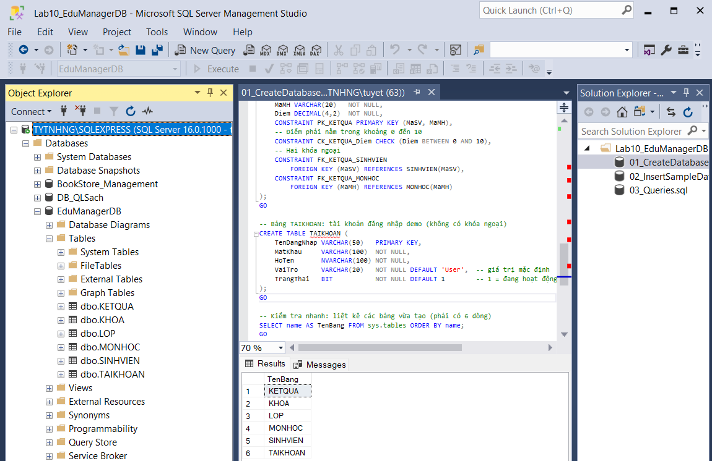 |
| Số dòng từng bảng | 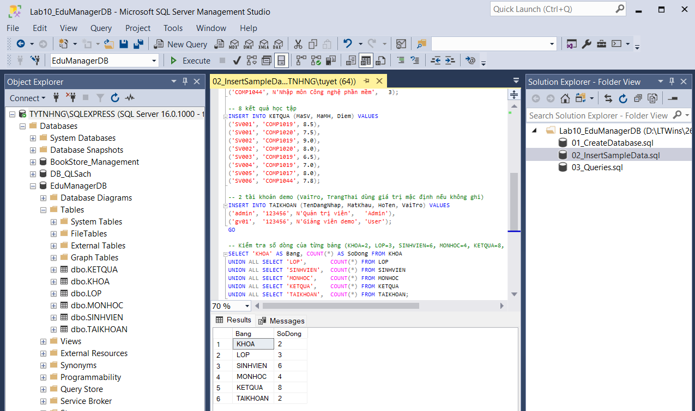 |
| Câu 1: toàn bộ sinh viên | 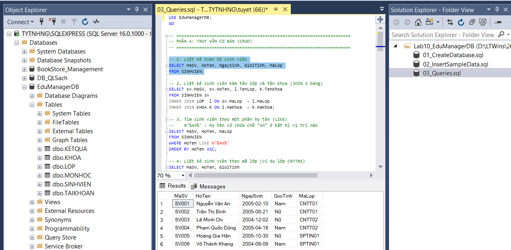 |
| Câu 2: JOIN sinh viên, lớp, khoa | 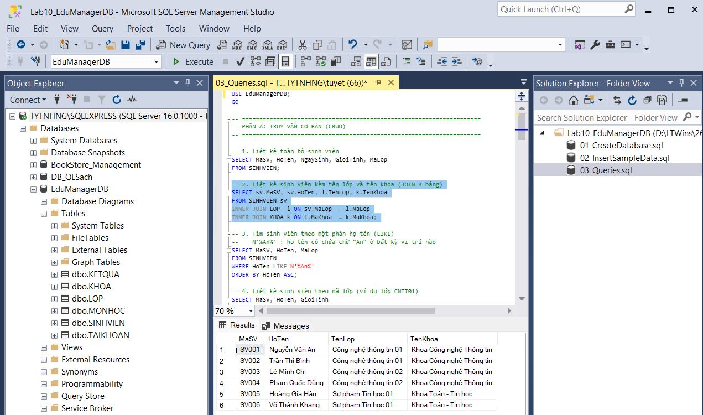 |
| Câu 3: tìm theo LIKE | 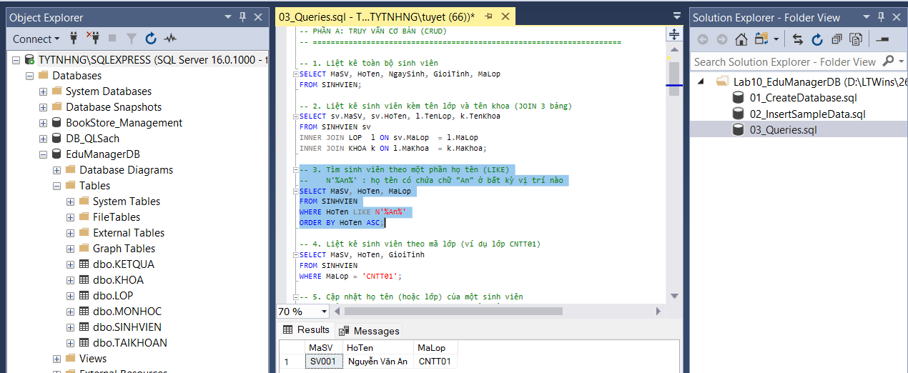 |
| Câu 4: sinh viên theo lớp CNTT01 | 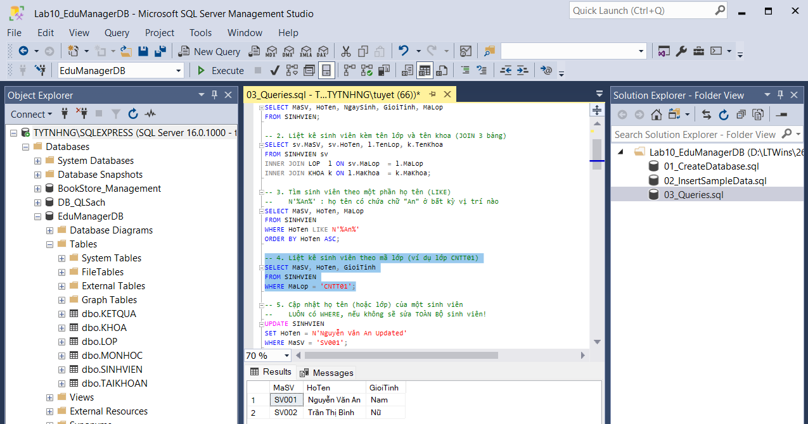 |
| Câu 5: UPDATE | 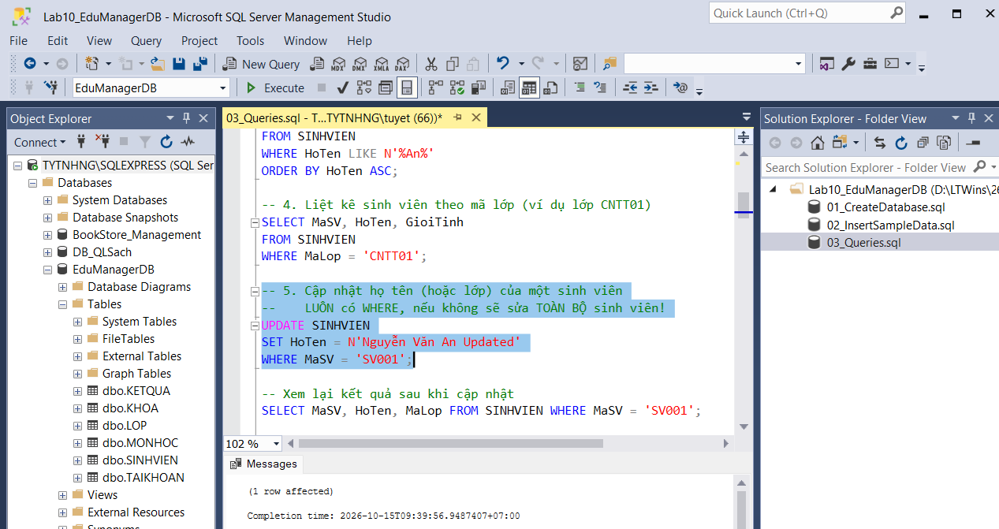 |
| Câu 5: kiểm tra sau UPDATE | 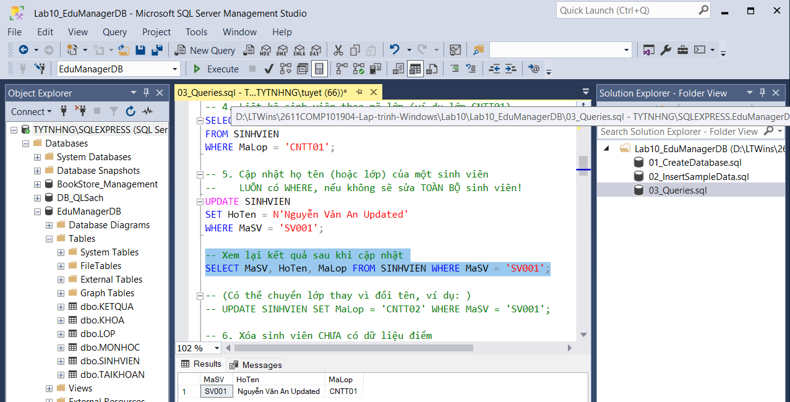 |
| Câu 6a: thêm SV099 | 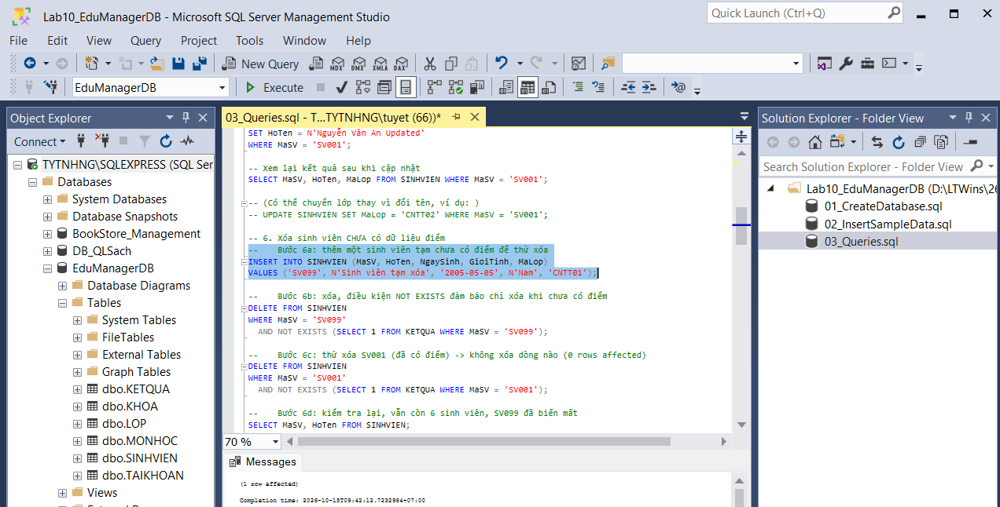 |
| Câu 6b: xóa SV099 | 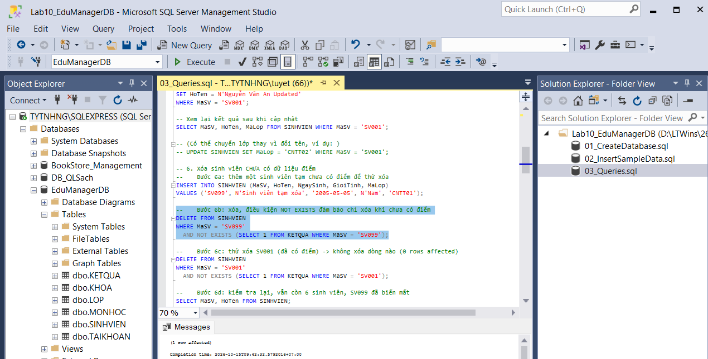 |
| Câu 6c: không xóa SV001 vì đã có điểm | 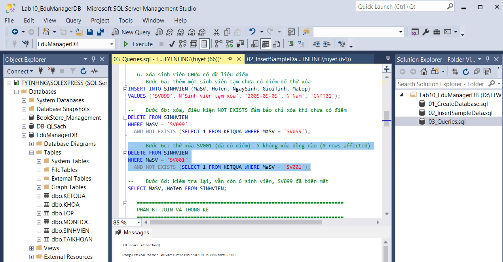 |
| Câu 6d: kiểm tra sau khi xóa | 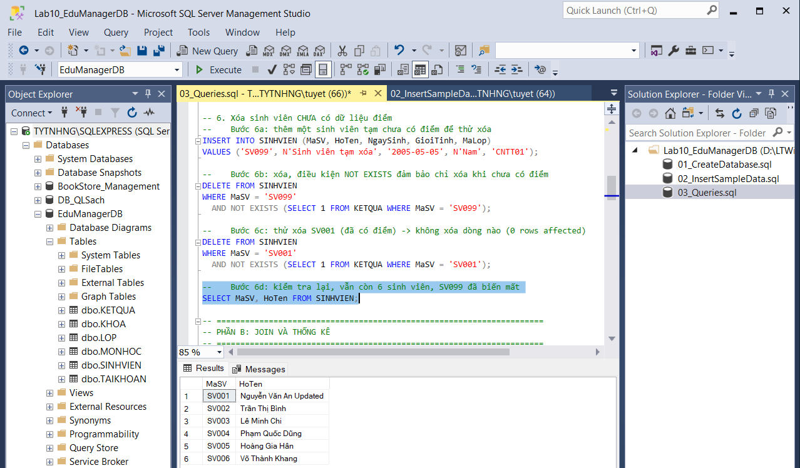 |
| Câu 7: điểm từng môn | 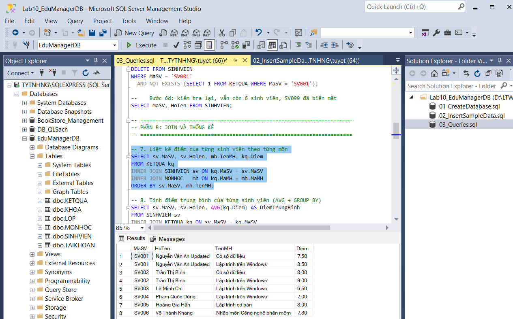 |
| Câu 8: điểm trung bình | 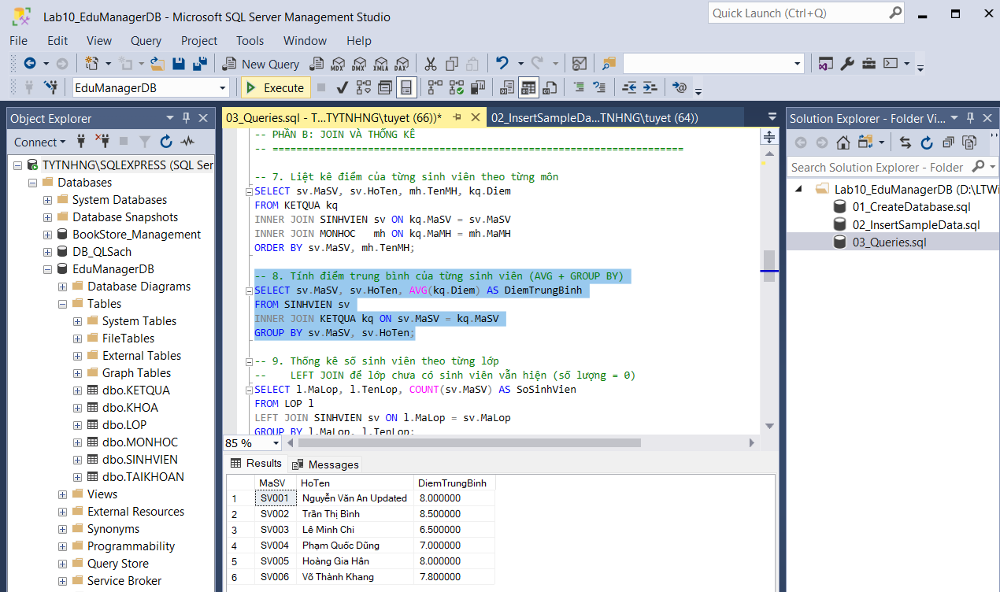 |
| Câu 9: số sinh viên theo lớp | 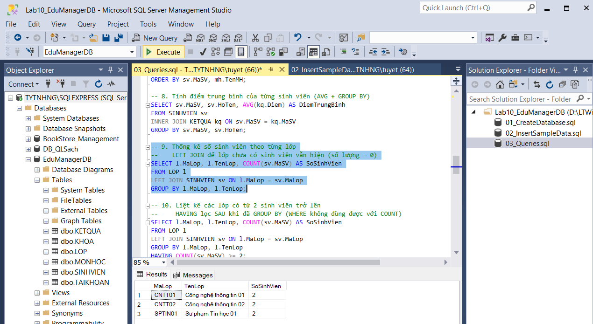 |
| Câu 10: lớp có từ 2 sinh viên | 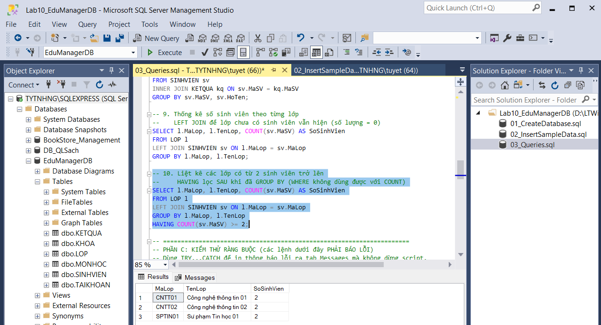 |
| Câu 11: lỗi khóa ngoại | 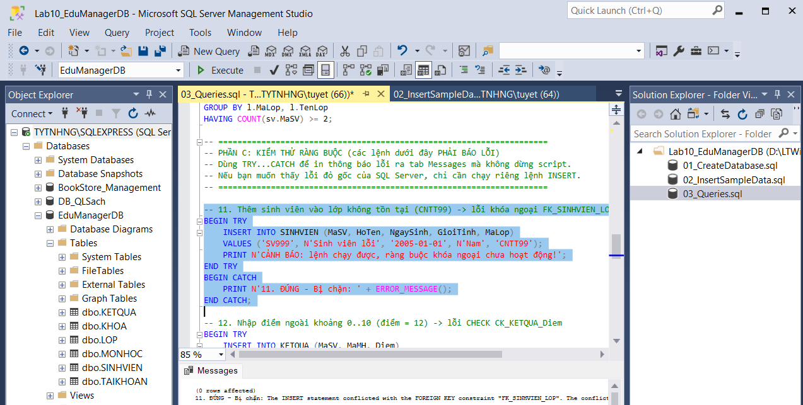 |
| Câu 12: lỗi CHECK điểm | 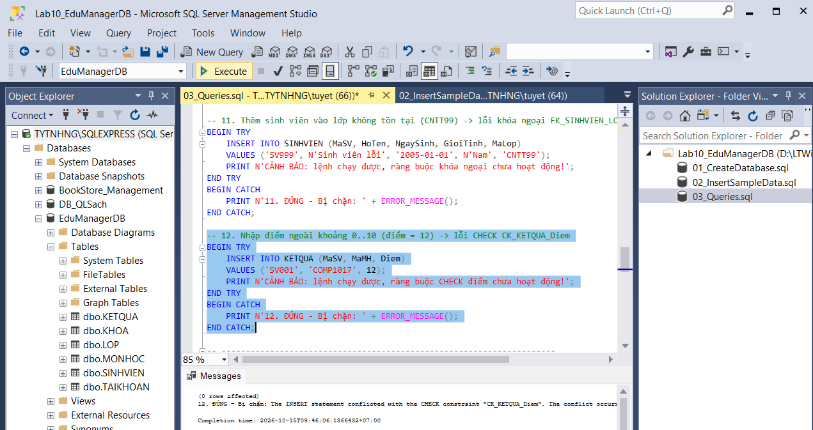 |

