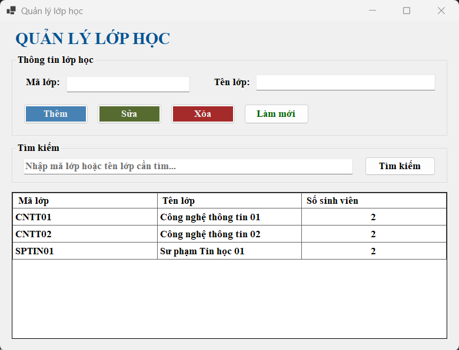
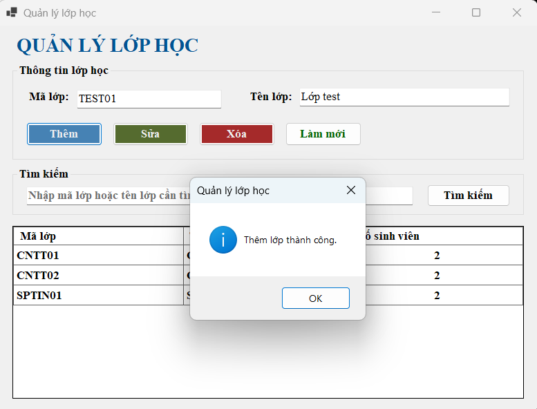
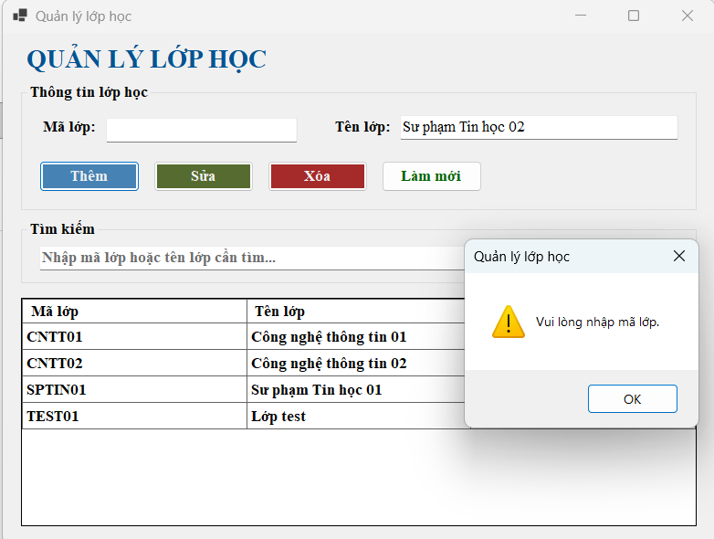
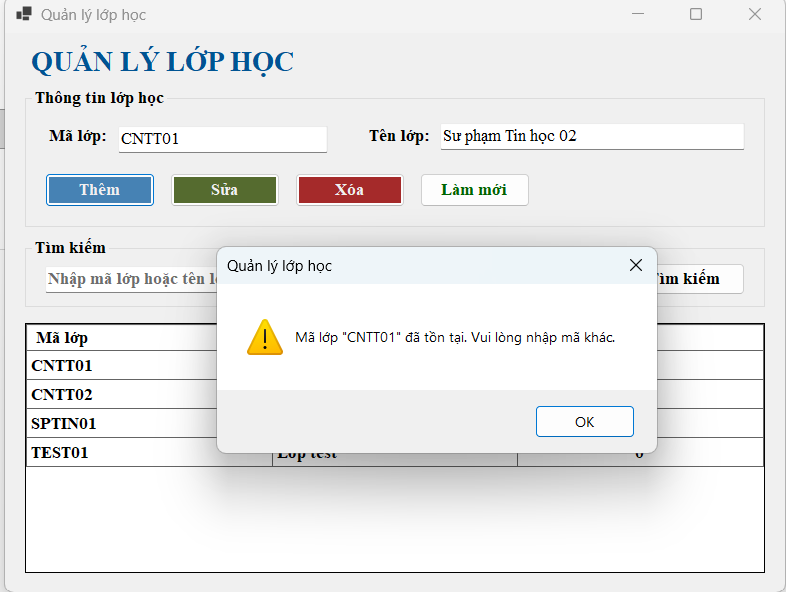
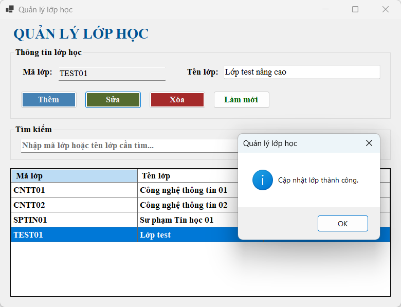
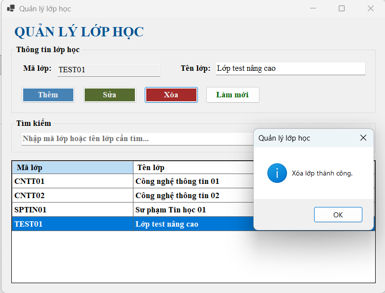
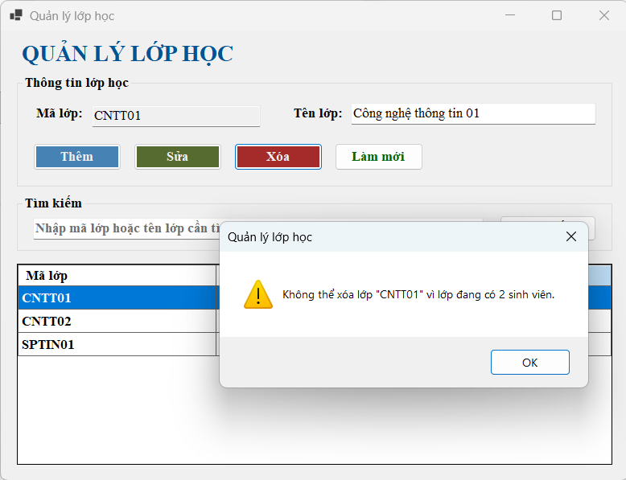
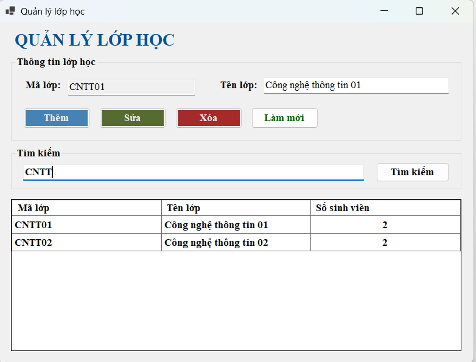

# Lab 11 - Quản lý lớp học bằng WinForms, ADO.NET và SQL Server

## Thông tin sinh viên
- Họ tên: Võ Ngọc Tuyết Nhung
- MSSV: 49.01.103.058
- Lớp: 49.01.SPTIN.A

## Mô tả
Ứng dụng WinForms quản lý lớp học bằng DataGridView, kết nối trực tiếp với database `EduManagerDB` trên SQL Server bằng ADO.NET (`SqlConnection`, `SqlCommand`, `SqlDataAdapter`, thư viện `Microsoft.Data.SqlClient`).

Dữ liệu lớp học được lưu trong bảng `LOP`, không lưu tạm bằng `List<T>`. Mọi câu SQL nhận dữ liệu từ người dùng đều dùng `SqlParameter`, không nối chuỗi trực tiếp.

- Học phần: COMP1019 - Lập trình trên Windows
- Công nghệ: C#, .NET 8 (Windows Forms), SQL Server, `Microsoft.Data.SqlClient`

## Chức năng
- F1: Tự động load danh sách lớp (kèm số sinh viên của từng lớp) từ SQL Server lên DataGridView khi mở Form
- F2: Chọn một dòng trên DataGridView thì đưa dữ liệu lên `txtMaLop` và `txtTenLop` (mã lớp bị khóa khi đang chọn)
- F3: Thêm lớp mới, không cho thêm nếu mã lớp rỗng, tên lớp rỗng hoặc mã lớp đã tồn tại
- F4: Sửa tên lớp theo mã lớp đang chọn, không cho sửa nếu chưa chọn lớp
- F5: Xóa lớp, hỏi xác nhận trước khi xóa, không cho xóa lớp đang có sinh viên (xử lý thêm lỗi khóa ngoại của SQL Server)
- F6: Tìm kiếm theo mã lớp hoặc tên lớp bằng `LIKE` và parameter (có thể nhấn Enter trong ô tìm kiếm)
- F7: Làm mới: xóa nội dung TextBox, mở khóa `txtMaLop` và load lại dữ liệu
- F8: Toàn bộ câu SQL có dữ liệu người dùng đều dùng `SqlParameter`


## Cơ sở dữ liệu
- File script: [`EduManagerDB.sql`](EduManagerDB.sql) (tạo database, các bảng và dữ liệu mẫu)
- Bảng sử dụng trong bài: `LOP(MaLop, TenLop, MaKhoa)` và `SINHVIEN(MaSV, HoTen, ..., MaLop)`
- `SINHVIEN.MaLop` là khóa ngoại tham chiếu `LOP.MaLop`
- Dữ liệu mẫu: 3 lớp (`CNTT01`, `CNTT02`, `SPTIN01`), mỗi lớp có 2 sinh viên


## Connection string
Connection string đang dùng trên máy cá nhân (khai báo trong `FrmLop.cs`):

```csharp
Data Source=TYTNHNG\SQLEXPRESS;Initial Catalog=EduManagerDB;Integrated Security=True;TrustServerCertificate=True
```

Khi chạy trên máy khác, cần đổi `Data Source` cho phù hợp, ví dụ:

| Trường hợp | Data Source |
|------------|-------------|
| SQL Server Express | `.\SQLEXPRESS` |
| SQL Server mặc định | `.` hoặc `localhost` |
| LocalDB | `(localdb)\MSSQLLocalDB` |

## Cách chạy
1. Mở SSMS, kết nối vào SQL Server, chạy file `EduManagerDB.sql` để tạo database và dữ liệu mẫu
2. Mở file `.sln` bằng Visual Studio 2022 (cần workload .NET desktop development, .NET 8)
3. Sửa `connectionString` trong `FrmLop.cs` cho đúng tên SQL Server trên máy của bạn
4. Restore NuGet package (Visual Studio tự động làm), nếu thiếu thì chạy:
   ```
   dotnet add package Microsoft.Data.SqlClient
   ```
5. Build solution (Ctrl + Shift + B)
6. Chạy project (F5)

## Ảnh chụp màn hình

| Chức năng | Ảnh |
|-----------|-----|
| Form load dữ liệu từ SQL Server |  |
| Thêm lớp hợp lệ |  |
| Thêm thiếu mã lớp |  |
| Thêm trùng mã lớp |  |
| Sửa lớp hợp lệ |  |
| Xóa lớp hợp lệ |  |
| Xóa lớp đang có sinh viên |  |
| Tìm kiếm |  |
