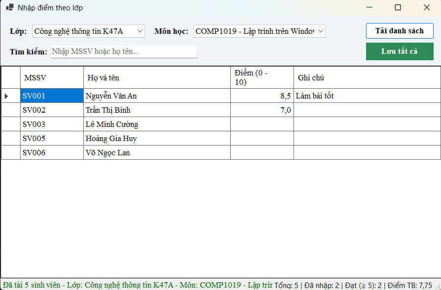
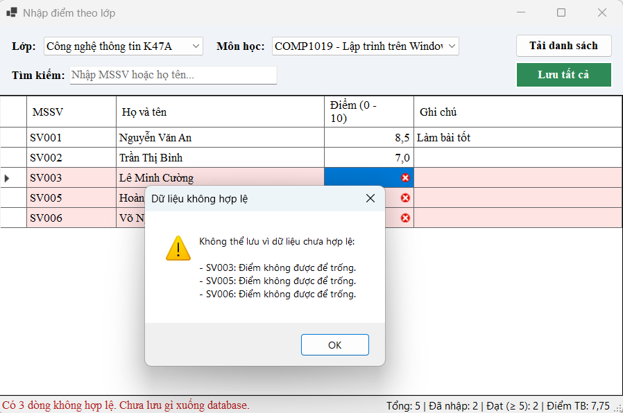
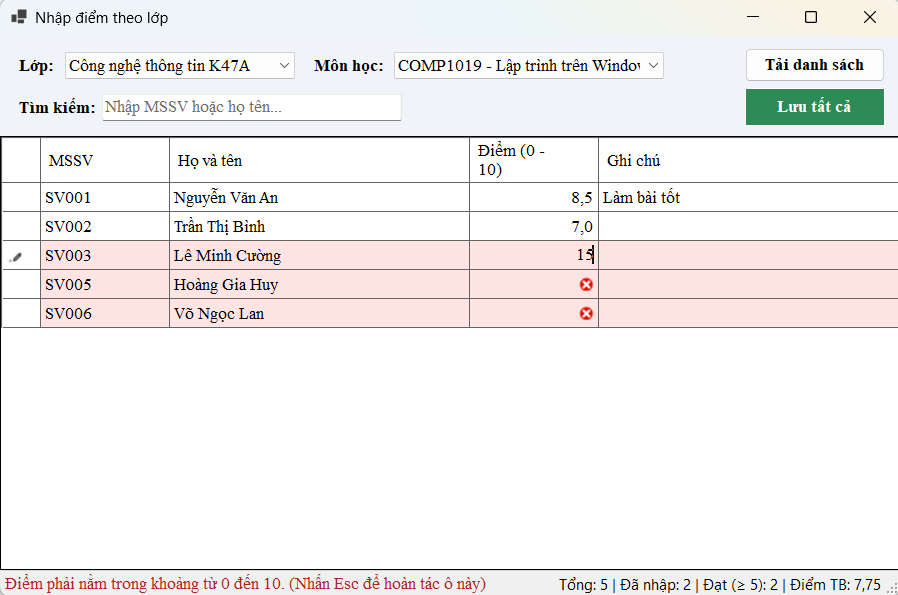
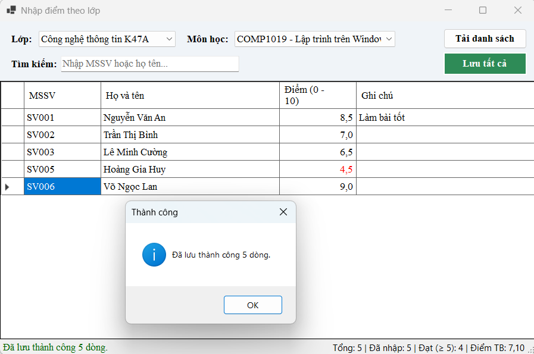
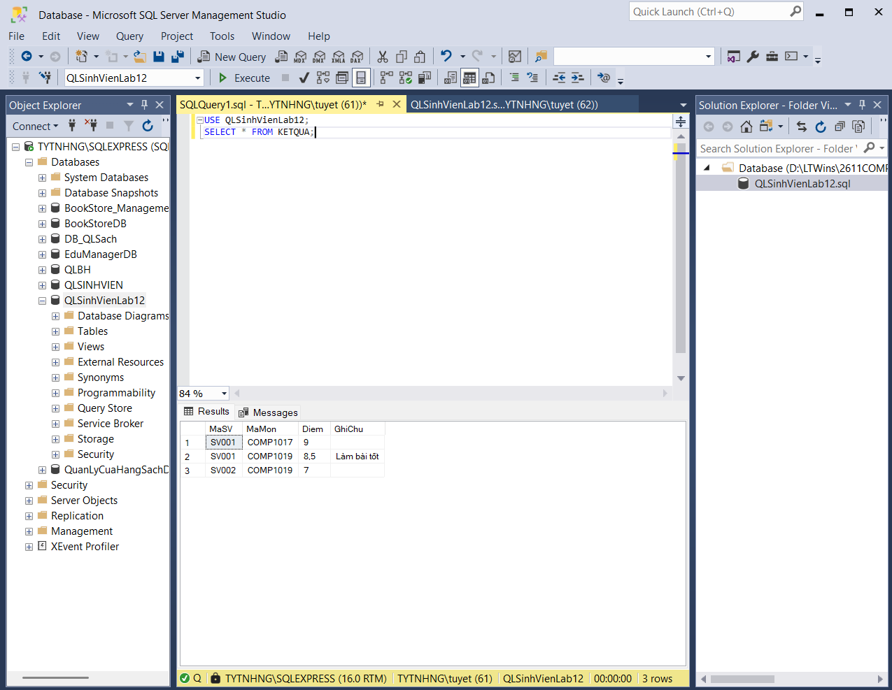
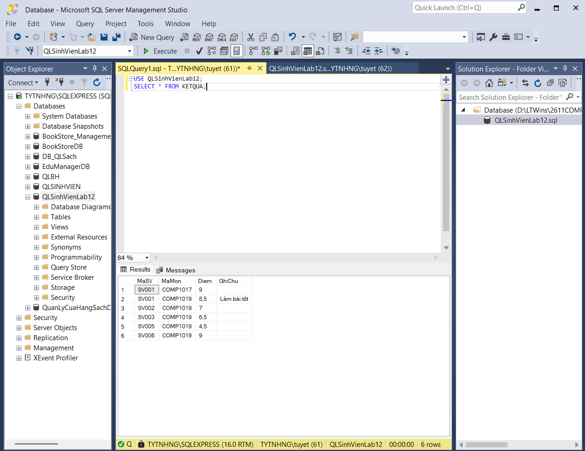
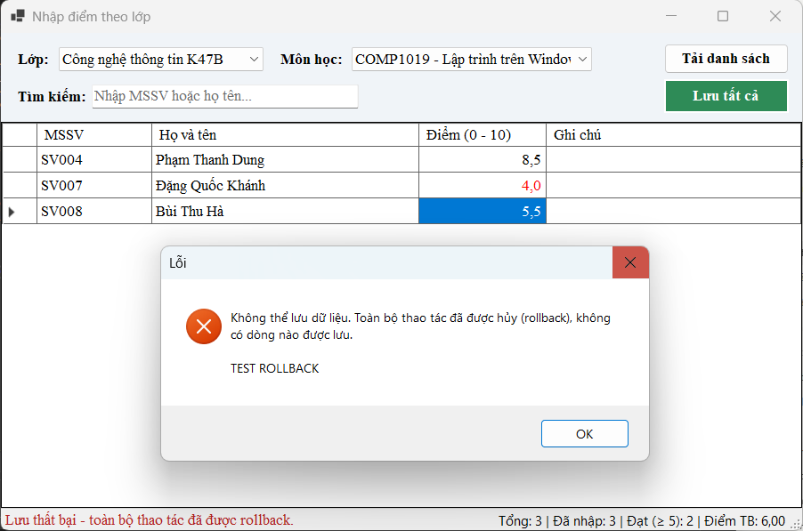
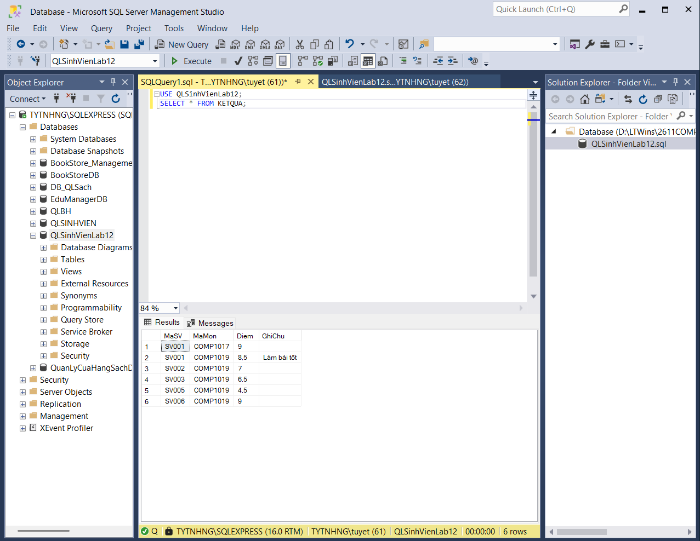

# Lab 12 - Quản lý kết quả học tập (Data Binding, Stored Procedure, Transaction)

## Thông tin sinh viên

- Họ tên: Võ Ngọc Tuyết Nhung
- MSSV: 49.01.103.058
- Lớp: 49.01.SPTIN.A

## Mô tả

Ứng dụng WinForms **nhập điểm theo lớp và môn học**. Người dùng chọn lớp, chọn môn học, bấm **Tải danh sách** để xem sinh viên của lớp đó, nhập hoặc sửa điểm rồi bấm **Lưu tất cả**.

- Nếu **toàn bộ** dữ liệu hợp lệ thì lưu xuống database trong **một transaction** (commit).
- Nếu **có bất kỳ dòng nào lỗi** thì **rollback toàn bộ**, không có dòng nào được lưu.

## Công nghệ sử dụng

- C# WinForms (.NET 8), Visual Studio 2022
- SQL Server (Express), SQL Server Management Studio
- ADO.NET, thư viện `Microsoft.Data.SqlClient`
- `DataTable`, `SqlDataAdapter`, `BindingSource`, `DataGridView`, `ComboBox`

## Chức năng

1. Khi mở Form, tải danh sách **lớp** và **môn học** vào hai ComboBox (`DisplayMember` / `ValueMember`).
2. Chọn lớp + môn học, bấm **Tải danh sách** để hiển thị sinh viên lên `DataGridView` (kèm điểm nếu đã có).
3. Nhập hoặc sửa trực tiếp cột **Điểm** và **Ghi chú**.
4. Kiểm tra điểm: không được rỗng, phải là số, nằm trong khoảng **0 đến 10** (kiểm tra ngay khi nhập ô và khi bấm Lưu).
5. **Lưu tất cả** bằng transaction: một dòng lỗi thì rollback toàn bộ và báo lỗi.
6. Lưu thành công thì commit và thông báo số dòng đã lưu.

**Mở rộng:**

- Tìm kiếm/lọc theo MSSV hoặc họ tên (lọc trên bộ nhớ bằng `BindingSource.Filter`).
- Thống kê trên thanh trạng thái: tổng số, đã nhập, số sinh viên đạt (điểm từ 5), điểm trung bình.
- Tô đỏ điểm dưới 5, tô nền hồng dòng bị lỗi.
- Cảnh báo khi còn thay đổi chưa lưu (khi tải lại danh sách hoặc đóng Form).
- Lưu theo đúng lớp/môn tại thời điểm tải danh sách, tránh ghi nhầm điểm sang môn khác nếu đổi ComboBox sau khi tải.


## Cấu trúc database

Database: **QLSinhVienLab12**

| Bảng | Cột | Ràng buộc |
|---|---|---|
| `LOP` | MaLop, TenLop | Khóa chính: MaLop |
| `SINHVIEN` | MaSV, HoTen, NgaySinh, MaLop | Khóa chính: MaSV; MaLop tham chiếu `LOP` |
| `MONHOC` | MaMon, TenMon, SoTinChi | Khóa chính: MaMon |
| `KETQUA` | MaSV, MaMon, Diem, GhiChu | Khóa chính: (MaSV, MaMon); MaSV tham chiếu `SINHVIEN`, MaMon tham chiếu `MONHOC`; `Diem` trong khoảng 0 đến 10 |

**Stored procedure:**

| Tên | Chức năng |
|---|---|
| `sp_Lop_GetAll` | Lấy danh sách lớp |
| `sp_MonHoc_GetAll` | Lấy danh sách môn học |
| `sp_KetQua_GetByLopMon` | Lấy sinh viên theo lớp và môn học, kèm điểm nếu đã có (`LEFT JOIN`, chưa có điểm thì `Diem = NULL`) |
| `sp_KetQua_Save` | Đã có điểm thì cập nhật, chưa có thì thêm mới (kiểm tra điểm 0-10 một lần nữa ở phía database) |

## Cài đặt database

1. Mở **SQL Server Management Studio** và kết nối vào SQL Server của máy.
2. Mở file `QLSinhVienLab12/Database/QLSinhVienLab12.sql`.
3. Bấm **Execute** (F5). Script sẽ **xóa database `QLSinhVienLab12` nếu đã tồn tại rồi tạo lại**, gồm bảng, dữ liệu mẫu và 4 stored procedure, nên có thể chạy lại nhiều lần để đưa dữ liệu về ban đầu.
4. Mở file `QLSinhVienLab12/DAL/Database.cs` và sửa hằng số `ServerName` cho đúng máy:

```csharp
public const string ServerName = @".\SQLEXPRESS";  
```

Mặc định dùng Windows Authentication (`Integrated Security=True`). Nếu dùng SQL Authentication thì sửa chuỗi kết nối trong `ConnectionString` cùng file.

## Cách chạy

1. Mở file `QLSinhVienLab12/QLSinhVienLab12.sln` bằng Visual Studio 2022 (cần workload **.NET desktop development** và .NET 8 SDK).
2. **Build → Rebuild Solution** (NuGet tự khôi phục `Microsoft.Data.SqlClient`, cần Internet).
3. Nhấn **F5** để chạy.

Dữ liệu mẫu: 3 lớp (CTK47A, CTK47B, CTK47C), 10 sinh viên, 3 môn học. Nên thử với **lớp CTK47A + môn COMP1019**: có 2 sinh viên đã có điểm và 3 sinh viên chưa có điểm.

## Thiết kế xử lý

- **Tách lớp:** `Database` giữ connection string; `KetQuaDAL` chứa toàn bộ truy cập database; Form chỉ lo giao diện và gọi DAL.
- **Không nối chuỗi SQL:** mọi truy vấn gọi stored procedure với `SqlParameter` có khai báo kiểu.
- **Transaction:** `SaveAll` mở một kết nối, `BeginTransaction`, gọi `sp_KetQua_Save` cho từng dòng bằng chung kết nối và transaction, **chỉ `Commit` sau khi vòng lặp kết thúc**; có lỗi thì `Rollback` và ném lỗi ra Form để báo người dùng.
- **Validation hai lớp:** kiểm tra ở Form trước khi mở transaction, và kiểm tra lại trong `sp_KetQua_Save` cùng ràng buộc `CHECK` của bảng `KETQUA`.

## Kiểm thử

| # | Thao tác | Kết quả mong đợi |
|---|---|---|
| 1 | Chọn CTK47A + COMP1019, bấm Tải danh sách | Hiện 5 sinh viên, 3 người chưa có điểm (ô trống) |
| 2 | Bỏ trống điểm rồi bấm Lưu tất cả | Báo các dòng còn trống, không lưu gì |
| 3 | Nhập điểm `15` (ngoài 0-10) | Báo lỗi, giữ con trỏ ở ô, không lưu |
| 4 | Nhập đủ điểm hợp lệ rồi bấm Lưu tất cả | Báo "Đã lưu thành công N dòng", database có dữ liệu mới |
| 5 | Giả lập lỗi ở dòng thứ 3 khi lưu lớp CTK47B | Báo lỗi và rollback, bảng `KETQUA` không thay đổi |

Test 5 được thực hiện bằng cách tạm thêm một dòng ném lỗi trong vòng lặp của `SaveAll` (đã gỡ bỏ sau khi kiểm thử), để chứng minh các dòng đã thực thi trước đó cũng bị hủy.

## Hình ảnh minh họa

### Form trước khi lưu điểm



### Validation: điểm bỏ trống



### Validation: điểm ngoài khoảng 0-10



### Form sau khi lưu điểm thành công



### Database trước và sau khi lưu

| Trước khi lưu | Sau khi lưu |
|---|---|
|  |  |

### Rollback khi có lỗi



