# Lab 13 - Báo cáo sinh viên bằng LINQ

## Thông tin sinh viên
- Họ tên: Võ Ngọc Tuyết Nhung
- MSSV: 49.01.103.058
- Lớp: 49.01.SPTIN.A

## Mô tả
Ứng dụng **WinForms** báo cáo danh sách sinh viên theo lớp. Người dùng chọn lớp, chọn điều kiện kết quả học tập,
nhập từ khóa rồi bấm **Xem báo cáo**. Toàn bộ thao tác **lọc, sắp xếp, nhóm, thống kê** đều dùng **LINQ** trên
`List<SinhVien>`; kết quả hiển thị bằng `DataGridView`, số liệu tổng hợp hiển thị ở `StatusStrip`, và có thể
**xuất ra file CSV hoặc TXT**.

## Công nghệ sử dụng
- C# WinForms (.NET 8)
- LINQ: `Where`, `Select`, `OrderBy`, `OrderByDescending`, `ThenBy`, `GroupBy`, `Count`, `Average`, `Max`
- `DataGridView`, `StatusStrip`, `SaveFileDialog`
- Không dùng DevExpress / Crystal Reports (chỉ tìm hiểu ý tưởng, xem mục cuối)

## Chức năng
- **Khi mở Form:** nạp danh sách lớp vào `cboLop` (có thêm mục *Tất cả lớp*), nạp `Tất cả / Đạt / Không đạt` vào `cboKetQua`, nạp kiểu sắp xếp vào `cboSapXep`.
- **Xem báo cáo:** lọc theo lớp + kết quả + từ khóa (mã SV hoặc họ tên, không phân biệt hoa thường).
  Mặc định sắp xếp **giảm dần theo điểm** (cùng điểm xếp theo họ tên); có thể đổi sang *Mã SV tăng dần* hoặc *Họ tên A → Z*.
- **Thống kê theo lớp:** số lượng SV, số đạt, số không đạt, điểm trung bình, điểm cao nhất của từng lớp.
- **Xuất file:** lưu dữ liệu đang hiển thị ra CSV hoặc TXT (UTF-8), có xử lý lỗi (file đang mở, không có quyền ghi...).
- **Thanh trạng thái:** tổng số SV, số đạt, số không đạt, điểm trung bình.
- Sinh viên **không đạt** (điểm < 5) được tô chữ đỏ.
- **Validation và thông báo:** báo rõ khi không có dữ liệu phù hợp, khi không có dữ liệu để xuất, khi từ khóa quá 50 ký tự, khi ghi file bị lỗi.

## Dữ liệu mẫu
15 sinh viên thuộc 3 lớp (`CTK47A`, `CTK47B`, `CTK48A`), tạo trong hàm `TaoDuLieuMau()`.
Thuộc tính `KetQua` của `SinhVien` là **chỉ đọc**: trả về `"Đạt"` nếu `Diem >= 5`, ngược lại `"Không đạt"`.

## Cách chạy
1. Cài **Visual Studio 2022** với workload *.NET desktop development* (.NET 8).
2. Mở file `StudentReportDemo/StudentReportDemo.sln` bằng Visual Studio.
3. Build solution (`Ctrl + Shift + B`).
4. Nhấn `F5` để chạy.

**Cơ sở dữ liệu:** project **không dùng database**, dữ liệu lấy từ `List<SinhVien>` trong code nên không cần chạy script SQL hay sửa connection string.
**Tài khoản demo:** không có chức năng đăng nhập.

## Tổ chức code (Forms/FrmBaoCaoSinhVien.cs)
| Hàm | Nhiệm vụ | LINQ sử dụng |
|---|---|---|
| `TaoDuLieuMau()` | Tạo 15 sinh viên mẫu | - |
| `LoadComboBox()` | Nạp `cboLop`, `cboKetQua`, `cboSapXep` | `GroupBy`, `Select`, `OrderBy` |
| `KiemTraDauVao()` | Validation đầu vào | - |
| `LocDanhSach()` | Lọc theo lớp, kết quả, từ khóa và sắp xếp | `Where`, `OrderByDescending`, `ThenBy`, `OrderBy` |
| `XemBaoCao()` | Hiển thị báo cáo lên `dgvBaoCao` | `Select` (có đánh số STT) |
| `CapNhatThongKe()` | Cập nhật thanh trạng thái | `Count`, `Average` |
| `ThongKeTheoLop()` | Thống kê theo từng lớp | `GroupBy`, `Count`, `Average`, `Max` |
| `XuatFile()` | Lưu CSV/TXT bằng `SaveFileDialog`, bắt lỗi `try/catch` | - |

## Hình ảnh minh họa

### Màn hình khi mở Form
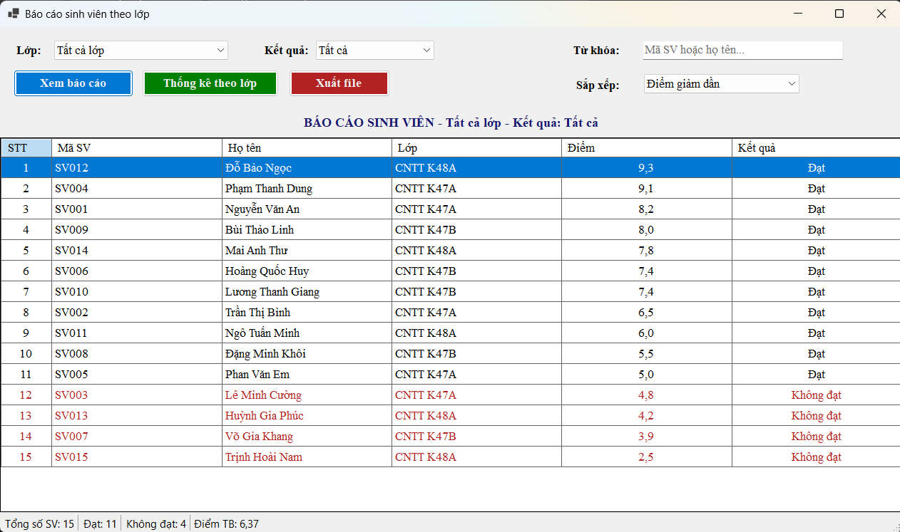

### Lọc dữ liệu (lớp CNTT K47A, kết quả Đạt)
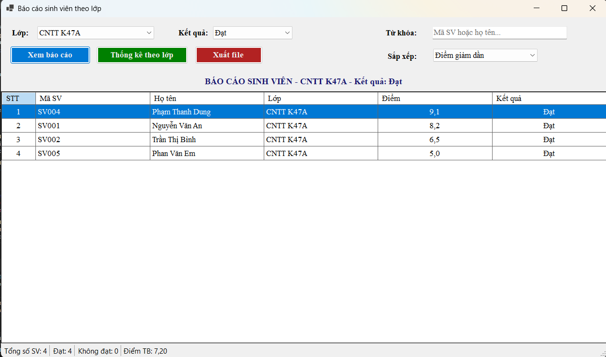

### Sắp xếp giảm dần theo điểm, cùng điểm xếp theo họ tên (lớp CNTT K47B)
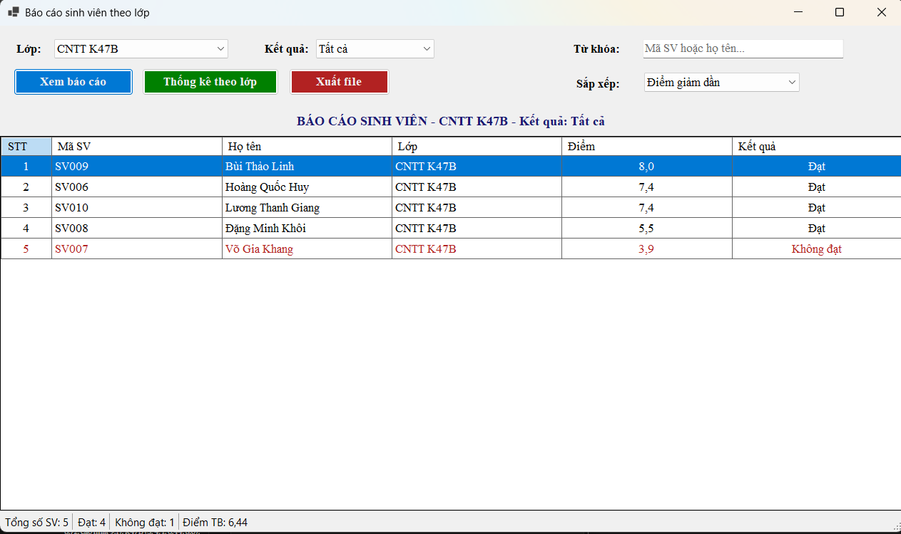

### Sắp xếp theo Mã SV tăng dần
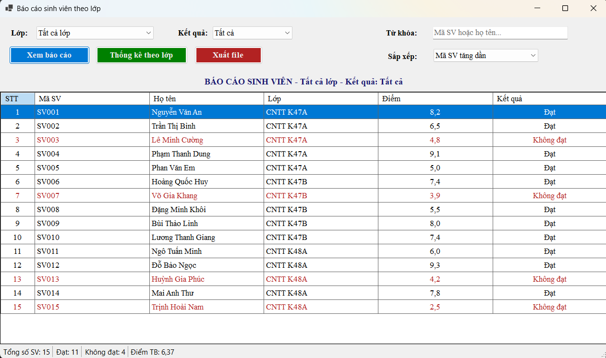

### Sắp xếp theo Họ tên A → Z
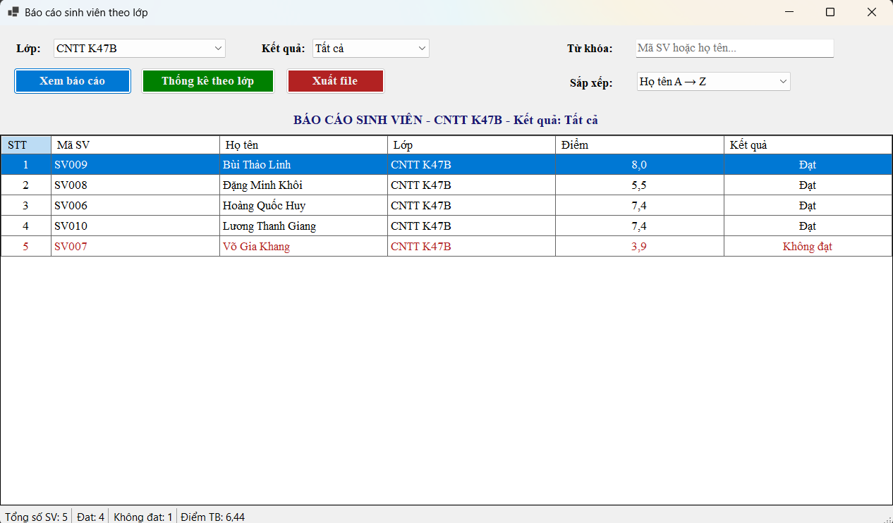

### Tìm kiếm theo mã sinh viên (`sv00`)
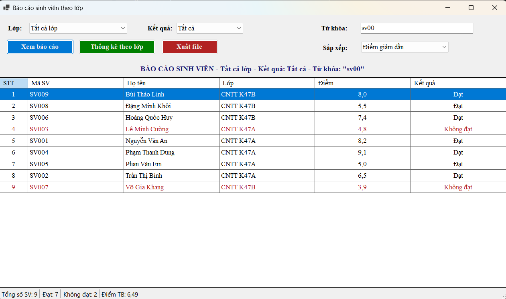

### Tìm kiếm theo họ tên (`huy`)
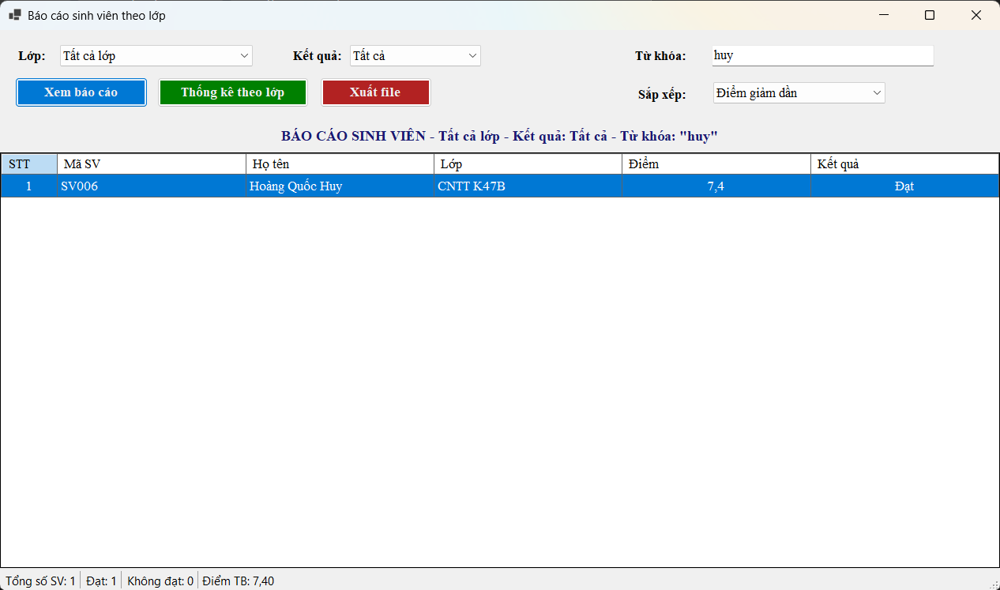

### Thống kê theo lớp
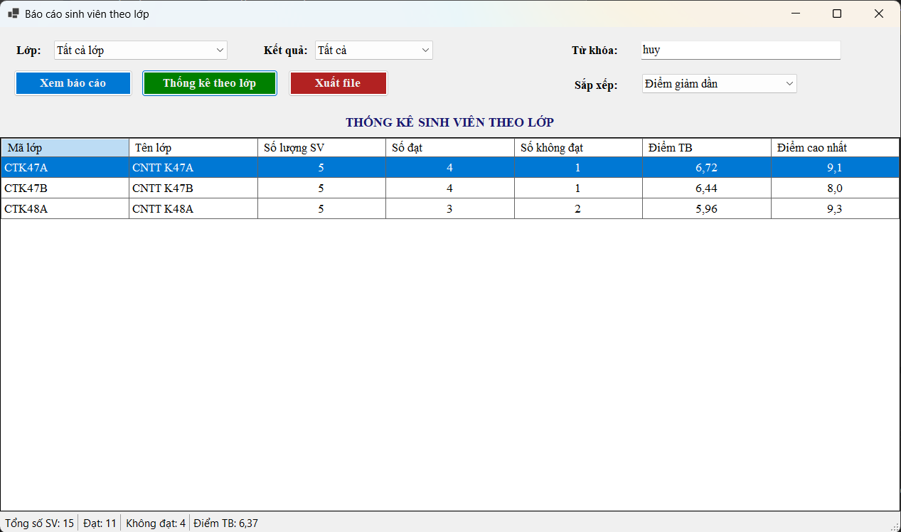

### Thông báo khi không có dữ liệu phù hợp
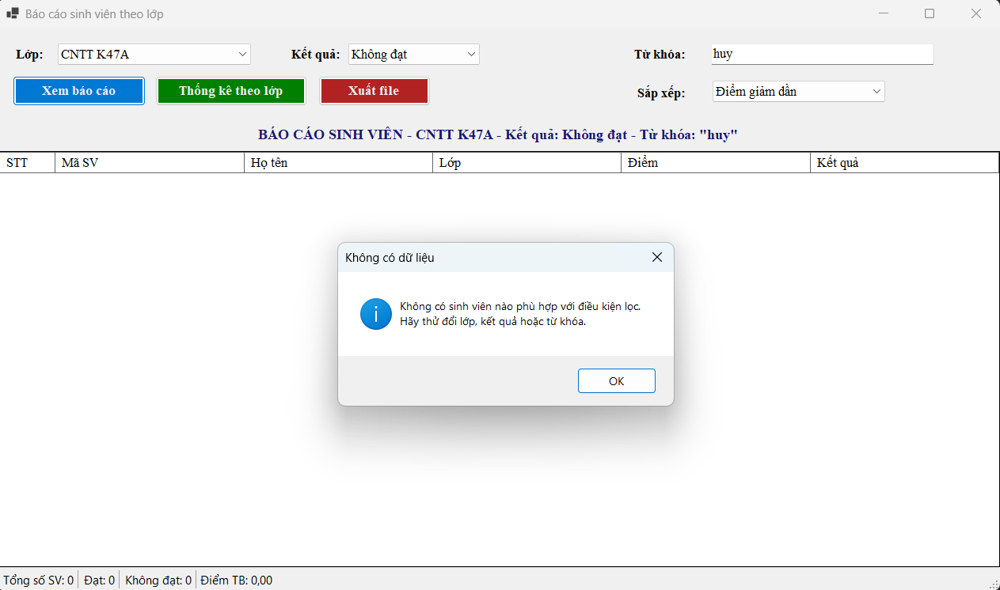

### Validation từ khóa quá dài
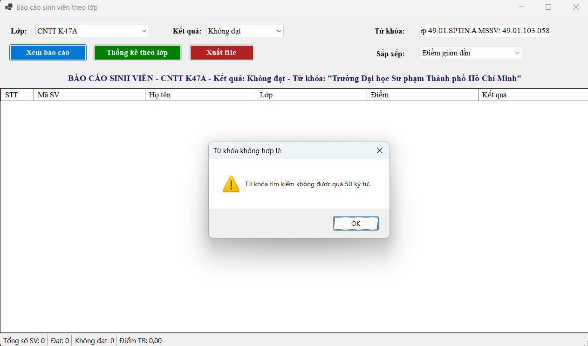

### Xuất file thành công
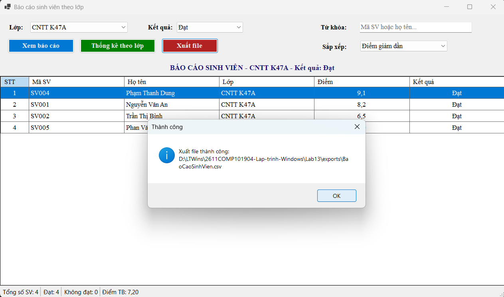

## File báo cáo đã xuất
- [`exports/BaoCaoSinhVien.csv`](exports/BaoCaoSinhVien.csv)
- [`exports/BaoCaoSinhVien.txt`](exports/BaoCaoSinhVien.txt)

> Nếu mở file CSV bằng Excel mà dữ liệu dồn vào một cột, vào *Data → From Text/CSV* và chọn dấu phân cách là dấu phẩy.

## Kết quả kiểm thử chính
| Kịch bản | Kết quả mong đợi |
|---|---|
| Mở Form | 15 SV, Đạt 11, Không đạt 4, ĐTB 6,37 |
| Lớp CNTT K47A + Đạt | 4 SV: 9,1 → 8,2 → 6,5 → 5,0 (điểm 5,0 tính là Đạt), ĐTB 7,20 |
| Lớp CNTT K47B + Tất cả | Hai SV cùng 7,4 được xếp theo họ tên |
| Từ khóa `sv00` | 9 SV từ SV001 đến SV009 |
| K47A + Không đạt + từ khóa `huy` | Hiện thông báo "Không có sinh viên nào phù hợp" |
| Thống kê theo lớp | K47A (ĐTB 6,72), K47B (6,44), K48A (5,96) |
| Xuất file khi bảng rỗng | Thông báo "Không có dữ liệu để xuất" |
| Xuất đè lên file đang mở trong Excel | Thông báo lỗi, chương trình không bị crash |

