# Lab 14 – EduManager: Quản lý môn học (Entity Framework Core + mô hình ba lớp)

- **Họ và tên:** Võ Ngọc Tuyết Nhung
- **MSSV:** 49.01.103.058
- **Lớp:** 49.01.SPTIN.A


---

## Giới thiệu

Module **Quản lý môn học** thuộc hệ thống EduManager. Ứng dụng Windows Forms cho phép thêm, sửa, xóa, tìm kiếm và xem danh sách môn học lưu trong SQL Server. Dữ liệu được truy cập bằng **Entity Framework Core** và mã nguồn được tổ chức theo **mô hình ba lớp GUI – BLL – DAL**.

## Công nghệ sử dụng

| Thành phần | Phiên bản |
|---|---|
| .NET (Windows Forms) | .NET 8 |
| Entity Framework Core | 8.0 (`Microsoft.EntityFrameworkCore.SqlServer`) |
| Cơ sở dữ liệu | SQL Server (SQL Express) |
| Công cụ | Visual Studio 2022, SQL Server Management Studio |


## Cơ sở dữ liệu

Bảng `MONHOC`:

| Tên cột | Kiểu dữ liệu | Ràng buộc | Ý nghĩa |
|---|---|---|---|
| MaMonHoc | nvarchar(10) | PRIMARY KEY, NOT NULL | Mã môn học |
| TenMonHoc | nvarchar(100) | NOT NULL | Tên môn học |
| SoTinChi | int | CHECK (1–6) | Số tín chỉ |
| TrangThai | bit | DEFAULT 1 | Còn sử dụng hay không |

> **Lưu ý về tên database:** đề yêu cầu `EduManagerDB`. Máy của em đã có sẵn một bảng `MONHOC` cũ với cấu trúc khác nên em dùng database **`EduManagerDB2`** để tránh xung đột. Nếu chạy trên máy sạch, có thể đổi `EduManagerDB2` thành `EduManagerDB` trong file `SQL/TaoCoSoDuLieu.sql` và trong chuỗi kết nối.

## 5. Hướng dẫn cài đặt và chạy

1. **Tạo CSDL:** mở `SQL/TaoCoSoDuLieu.sql` trong SSMS rồi nhấn **Execute**. Kết quả cuối script hiển thị 4 môn học mẫu.
2. **Sửa chuỗi kết nối** (hằng `ChuoiKetNoi`) trong `EduManager/Data/EduManagerContext.cs` cho khớp máy:
   - SQL Express: `Server=.\\SQLEXPRESS;Database=EduManagerDB2;Trusted_Connection=True;TrustServerCertificate=True;`
   - LocalDB: `Server=(localdb)\\MSSQLLocalDB;...`
   - SQL Server mặc định: `Server=localhost;...`
3. **Chạy:** mở `EduManager/EduManager.csproj` bằng Visual Studio, chờ restore NuGet, nhấn **F5**.

Hoặc dùng dòng lệnh:

```bash
cd EduManager
dotnet restore
dotnet run
```

## 6. Chức năng

| STT | Chức năng | Thực hiện |
|---|---|---|
| 1 | Load danh sách khi mở Form | `FrmMonHoc_Load` → `MonHocBLL.LayDanhSach` |
| 2 | Thêm môn học | `btnThem` → `MonHocBLL.ThemMonHoc` |
| 3 | Sửa môn học | `btnSua` → `MonHocBLL.SuaMonHoc` |
| 4 | Xóa (có xác nhận bằng MessageBox) | `btnXoa` → `MonHocBLL.XoaMonHoc` |
| 5 | Tìm kiếm theo mã hoặc tên | `btnTimKiem` hoặc phím Enter → `MonHocBLL.TimKiem` |
| 6 | Chọn dòng trên lưới thì hiện lên các control | `dgvMonHoc_CellClick` |
| 7 | Làm mới Form và load lại danh sách | `btnLamMoi` |

## 7. Kiến trúc ba lớp

Luồng gọi: `GUI → BLL → DAL → EF Core → SQL Server`.

| Lớp | Thành phần | Trách nhiệm |
|---|---|---|
| Models | `MonHoc` | Entity ánh xạ bảng MONHOC |
| Data | `EduManagerContext` | DbContext, cấu hình khóa chính, ràng buộc CHECK |
| DAL | `MonHocDAL` | Thêm, sửa, xóa, truy vấn bằng EF Core; không kiểm tra nghiệp vụ |
| BLL | `MonHocBLL` | Chuẩn hóa và kiểm tra dữ liệu, kiểm tra trùng mã, tạo thông báo lỗi, rồi mới gọi DAL |
| GUI | `FrmMonHoc` | Nhận dữ liệu từ control, gọi BLL, hiển thị kết quả; không viết SQL, không chứa logic nghiệp vụ |

## 8. Validation

Các quy tắc đặt ở BLL:

- Mã môn học không được rỗng (tối đa 10 ký tự).
- Tên môn học không được rỗng (tối đa 100 ký tự).
- Số tín chỉ phải nằm trong khoảng 1 đến 6.
- Không cho thêm mã môn học đã tồn tại.
- Mã phải tồn tại khi sửa hoặc xóa.
- Lỗi kỹ thuật (mất kết nối SQL Server...) được chuyển thành thông báo dễ hiểu.

Ở GUI: `NumericUpDown` giới hạn 1–6, `TextBox` có `MaxLength`, và có hộp thoại `MessageBox` xác nhận trước khi xóa.

## 9. Ảnh chụp màn hình và test case

### 9.1. Mở Form và thêm môn học

**TC01 – Load danh sách khi mở Form**
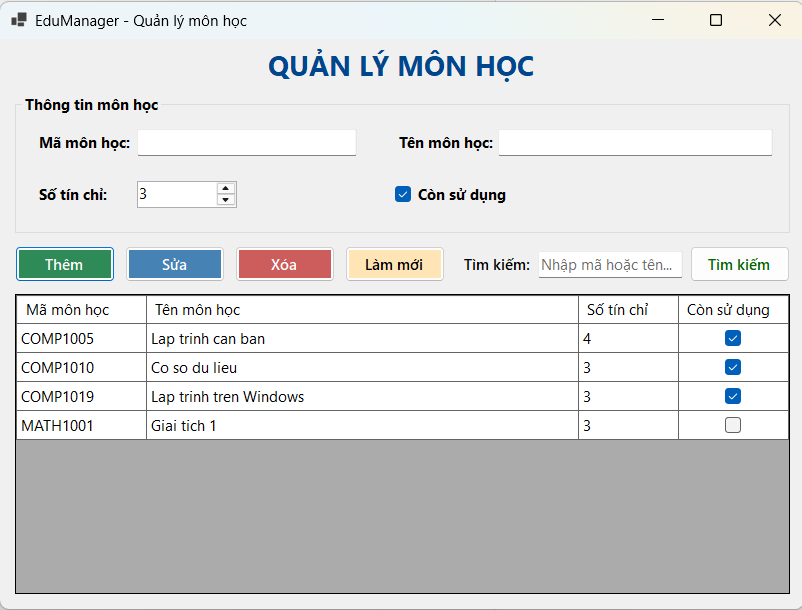

**TC02 – Thêm môn học hợp lệ**
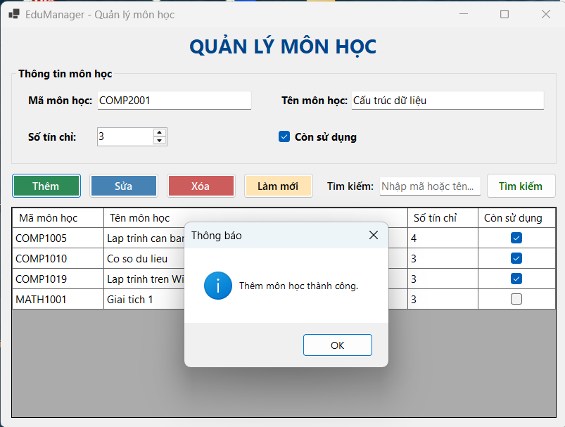
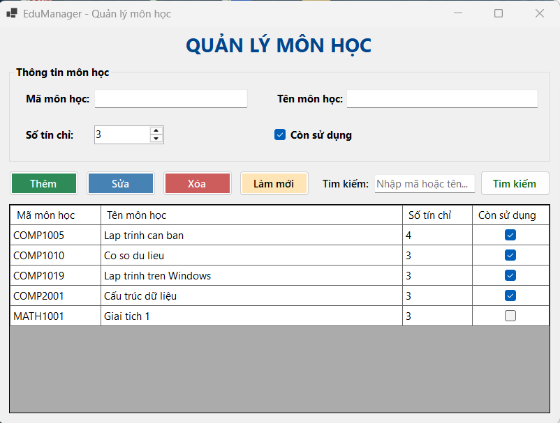

### 9.2. Validation

**TC03 – Mã môn học rỗng**


**TC04 – Tên môn học rỗng**
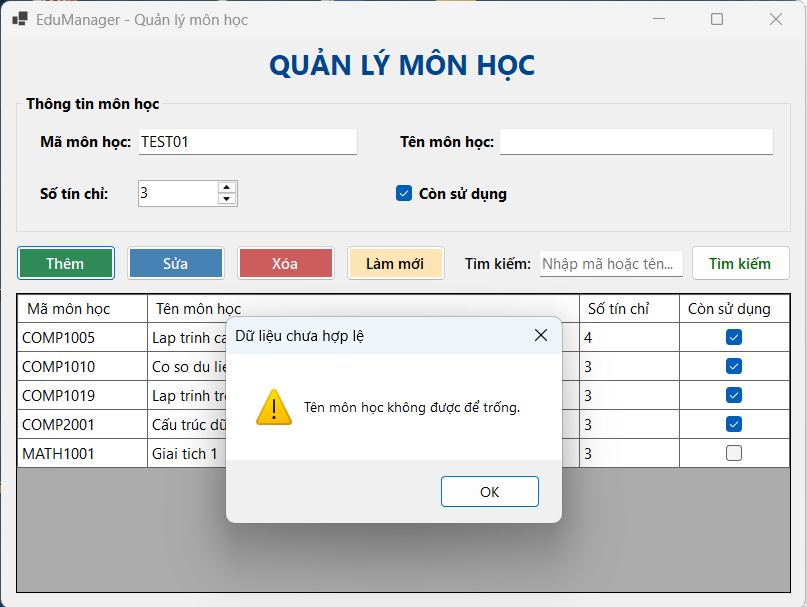

**TC05 – Trùng mã môn học**
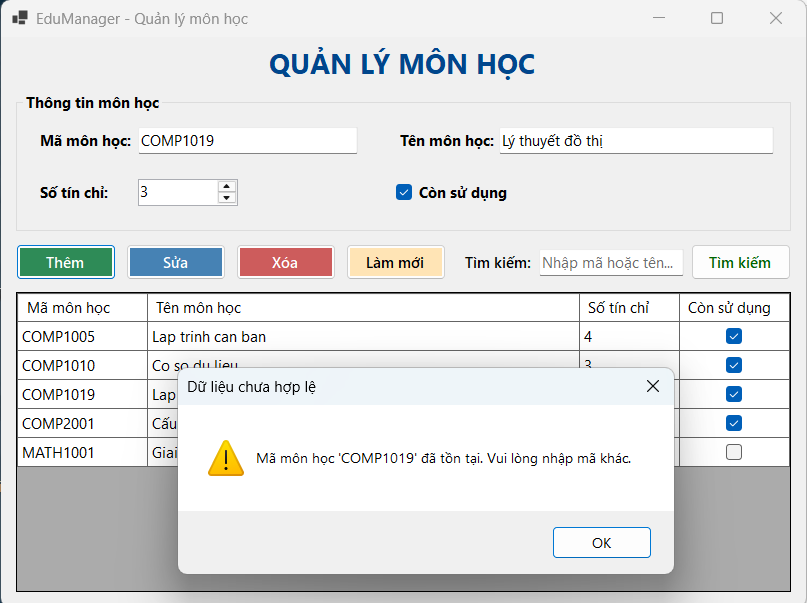

### 9.3. Chọn dòng, sửa, xóa

**TC06 – Chọn dòng thì dữ liệu hiện lên các control**
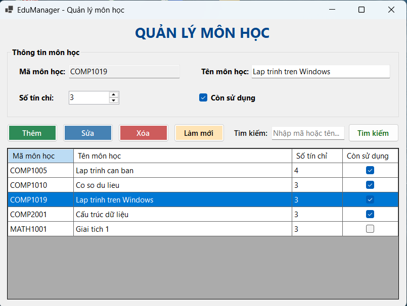

**TC07 – Sửa môn học**
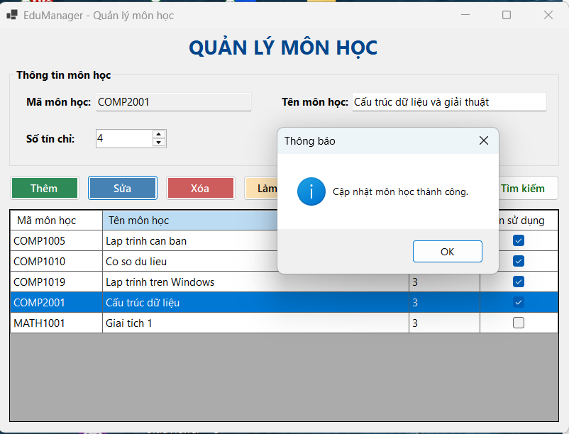

**TC08 – Hộp thoại xác nhận xóa**
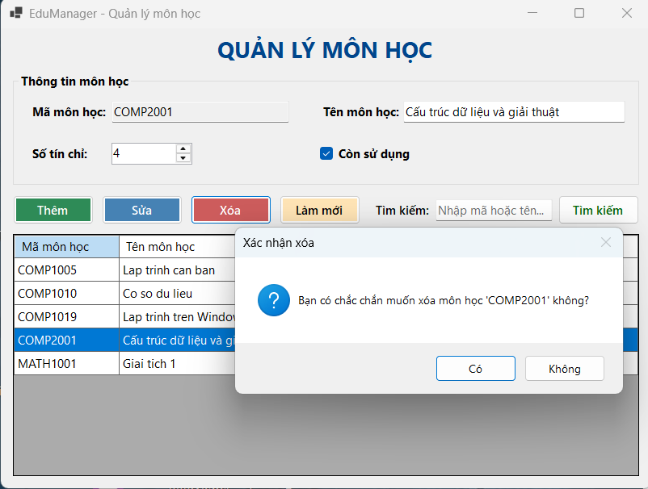

**TC09 – Xóa thành công**
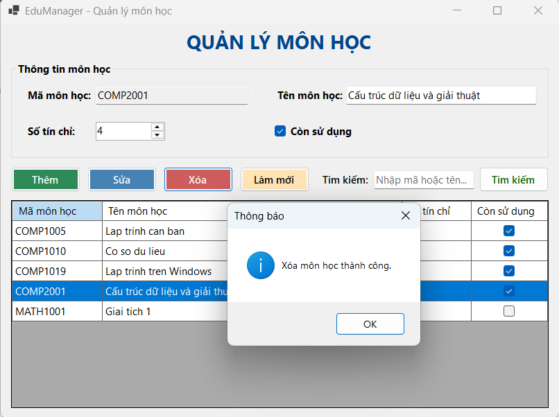

### 9.4. Tìm kiếm

**TC10 – Tìm theo mã**
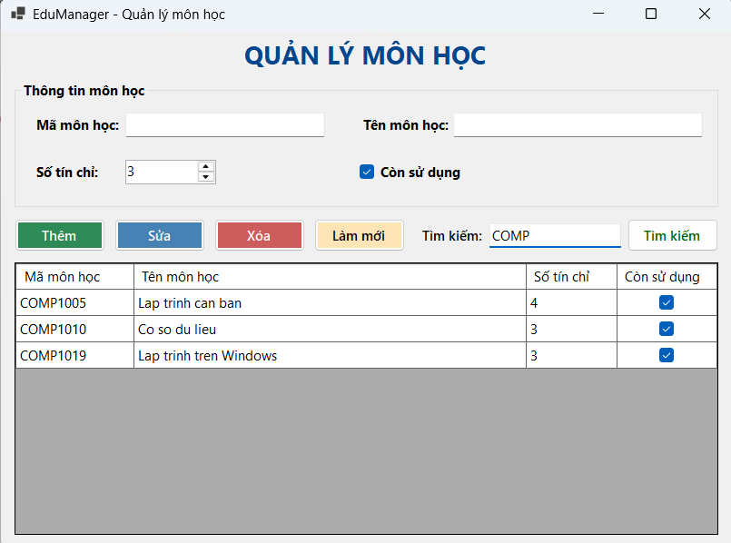

**TC11 – Tìm theo tên**
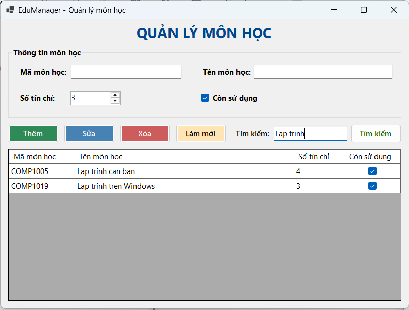

**TC12 – Tìm không có kết quả**
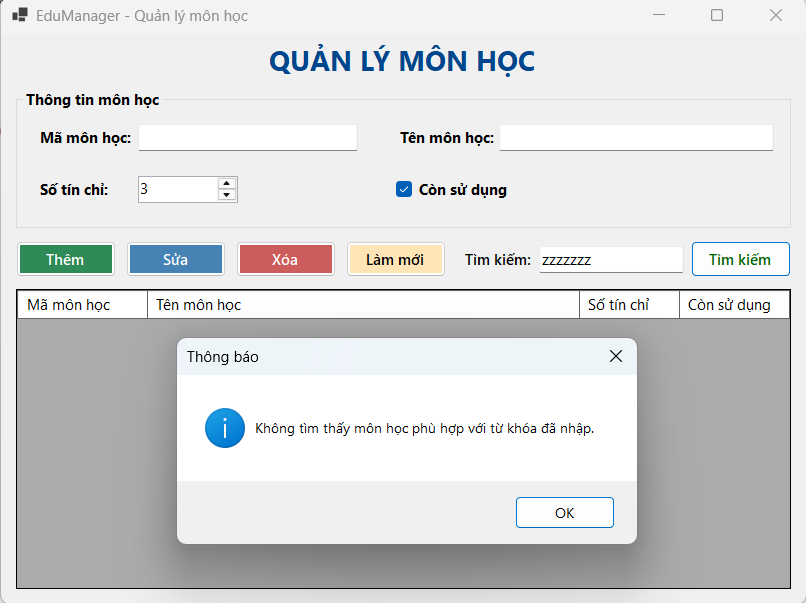

### 9.5. Đối chiếu cơ sở dữ liệu

Dữ liệu trong bảng `MONHOC` trên SSMS khớp với lưới hiển thị trên Form.
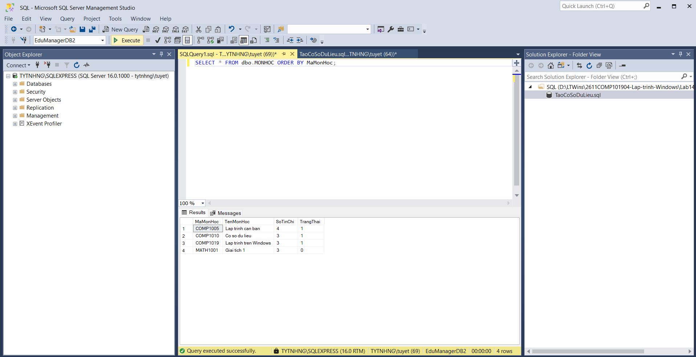


## 10. Trả lời câu hỏi nộp kèm

### Câu 1. Vì sao không nên viết toàn bộ code CRUD trong sự kiện Button Click?

- **Khó bảo trì và đọc hiểu:** giao diện, kiểm tra dữ liệu và truy cập CSDL lẫn vào một chỗ nên khi đổi một yêu cầu phải sửa nhiều Form.
- **Không tái sử dụng:** cùng một logic (ví dụ kiểm tra trùng mã) phải chép lại ở nhiều nút hoặc nhiều Form.
- **Khó kiểm thử:** không thể test logic nếu không mở giao diện; tách lớp cho phép kiểm thử BLL và DAL độc lập.
- **Khó thay đổi công nghệ:** đổi CSDL hoặc đổi giao diện (WinForms sang WPF/Web) sẽ phải viết lại toàn bộ.
- **Dễ lỗi và khó làm việc nhóm:** Form phình to, nhiều người cùng sửa một file dễ xung đột. Tách lớp đúng nguyên tắc đơn nhiệm (Single Responsibility) và giúp chia việc rõ ràng.

### Câu 2. BLL và DAL khác nhau ở điểm nào?

| Tiêu chí | BLL (Business Logic Layer) | DAL (Data Access Layer) |
|---|---|---|
| Vai trò | Xử lý quy tắc nghiệp vụ, kiểm tra dữ liệu | Truy cập và thao tác dữ liệu trong CSDL |
| Trong bài lab | `MonHocBLL`: kiểm tra rỗng, tín chỉ 1–6, trùng mã, tạo thông báo lỗi | `MonHocDAL`: `Add`, `Find`, `Remove`, `SaveChanges`, truy vấn bằng EF Core |
| Biết về | Quy tắc của bài toán | Cách lưu trữ và truy vấn dữ liệu |
| Không làm | Không truy vấn trực tiếp vào CSDL | Không quyết định dữ liệu có hợp lệ hay không |
| Gọi tới | DAL | EF Core / SQL Server |

Nói ngắn gọn: BLL quyết định *được hay không được* làm gì, còn DAL chỉ biết *làm thế nào* để đọc và ghi dữ liệu.

### Câu 3. Entity Framework khác ADO.NET ở điểm nào?

- **ADO.NET:** lập trình viên tự viết câu lệnh SQL, tạo `SqlConnection`, `SqlCommand`, `SqlParameter`, đọc `SqlDataReader` và tự ánh xạ từng cột sang đối tượng. Kiểm soát chi tiết, hiệu năng cao nhưng nhiều code lặp và dễ sai chuỗi SQL.
- **Entity Framework (ORM):** ánh xạ bảng sang lớp C# (Entity); thao tác bằng đối tượng và LINQ (`Add`, `Remove`, `Where`...), EF tự sinh SQL, theo dõi thay đổi (change tracking) và lưu bằng `SaveChanges()`. Code ngắn gọn, kiểm tra kiểu ngay lúc biên dịch, hỗ trợ Migration; đổi lại có thêm một lớp trừu tượng và với truy vấn rất phức tạp thì hiệu năng có thể kém hơn ADO.NET thuần.
- Về bản chất, EF Core được xây dựng phía trên ADO.NET (`Microsoft.Data.SqlClient`).

### Câu 4. Trong bài lab này, validation nào nên đặt ở BLL?

Các quy tắc nghiệp vụ nên đặt ở BLL (`MonHocBLL.KiemTraDuLieu` và các hàm Thêm/Sửa/Xóa):

1. Mã môn học không được rỗng (và không quá 10 ký tự).
2. Tên môn học không được rỗng (và không quá 100 ký tự).
3. Số tín chỉ nằm trong khoảng 1 đến 6.
4. Không cho thêm mã môn học đã tồn tại (BLL hỏi DAL rồi quyết định).
5. Mã phải tồn tại khi sửa hoặc xóa.
6. Chuyển lỗi kỹ thuật thành thông báo dễ hiểu cho người dùng.

GUI chỉ làm những việc thuộc về giao diện: giới hạn `NumericUpDown` 1–6, đặt `MaxLength` cho TextBox và hỏi xác nhận bằng `MessageBox` trước khi xóa. Các ràng buộc này không thay thế validation ở BLL.

