# Lab 15 – Quản lý sinh viên theo mô hình MVP

- **Sinh viên:** Võ Ngọc Tuyết Nhung
– **MSSV:** 49.01.103.058 
– **Lớp:** 49.01.SPTIN.A


## 1. Giới thiệu
Ứng dụng WinForms quản lý danh sách sinh viên (Mã, Họ tên, Điểm), được tách theo mô hình **MVP** cơ bản: Form chỉ nhận thao tác và gọi Presenter, toàn bộ xử lý nằm ở Presenter, dữ liệu nằm ở Repository.

Chức năng: Load danh sách, Thêm, Xóa theo mã, Tìm kiếm theo mã/tên (không phân biệt hoa thường, dấu); kiểm tra dữ liệu rỗng, sai kiểu, điểm ngoài khoảng 0–10, trùng mã; thông báo kết quả cho người dùng.

## 2. Môi trường
| Thành phần | Phiên bản |
|---|---|
| Hệ điều hành | Windows 10/11 |
| IDE | Visual Studio 2022 (workload *.NET desktop development*) |
| Framework | .NET 8 (`net8.0-windows`), Windows Forms |
| Cơ sở dữ liệu | Không dùng – lưu trong bộ nhớ bằng `List<Student>` |
| Tài khoản demo | Không có (ứng dụng không yêu cầu đăng nhập) |

## 3. Cách chạy
1. Clone hoặc tải project về máy:
   ```
   git clone <link repository>
   ```
2. Mở file `QuanLySinhVienMVP.csproj` bằng Visual Studio 2022.
3. Chờ Visual Studio restore xong, nhấn **F5** (hoặc **Ctrl + F5**) để chạy.
4. Khi chạy lên, Form tự hiển thị sẵn dữ liệu mẫu SV001 → SV006.

Chạy bằng dòng lệnh (tùy chọn): `dotnet run` trong thư mục chứa file `.csproj`.


## 4. Luồng hoạt động MVP
```
Người dùng bấm nút → FrmStudent (View) → StudentPresenter → IStudentRepository
                              ↑                  │
                              └── IStudentView ──┘  (ShowStudents, ShowMessage, ShowError, Confirm, ClearInput)
```
- Button Click chỉ gọi `Presenter.AddStudent()`, `DeleteStudent()`, `SearchStudents()`, `LoadStudents()`.
- Presenter **không** truy cập TextBox, DataGridView hay MessageBox; chỉ làm việc qua `IStudentView`.

## 5. Kiểm thử

| ID | Chức năng | Dữ liệu / Thao tác | Kết quả mong đợi | Ảnh |
|----|-----------|--------------------|------------------|-----|
| TC01 | Load danh sách | Mở Form | Hiển thị 6 sinh viên mẫu | 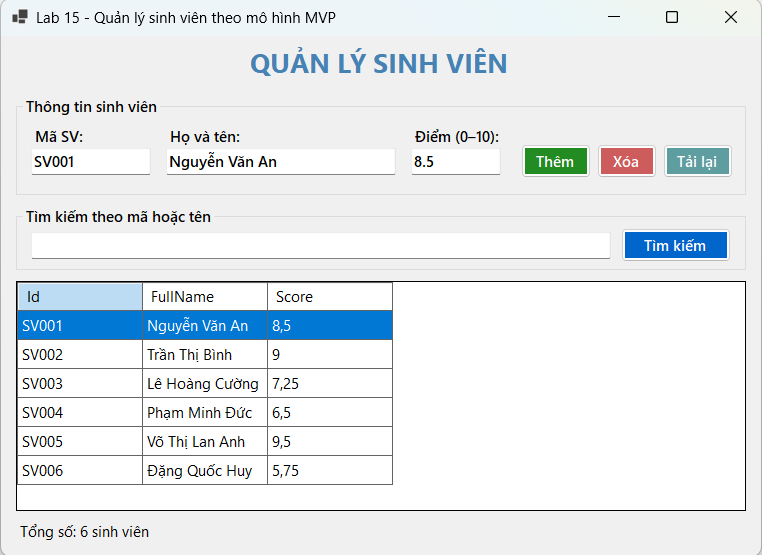 |
| TC02 | Thêm hợp lệ | Nhập mã mới, tên, điểm hợp lệ → Thêm | Thông báo thành công, lưới có 7 dòng | 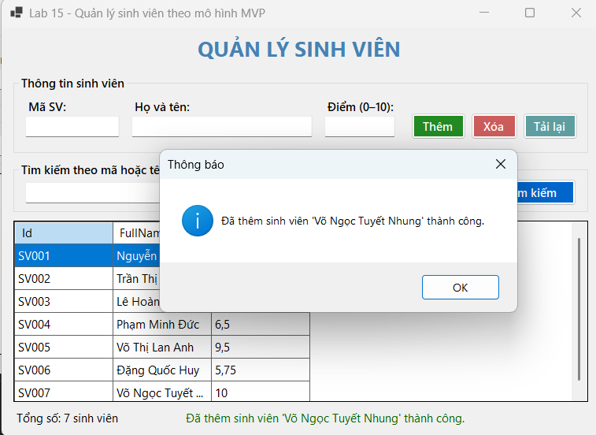 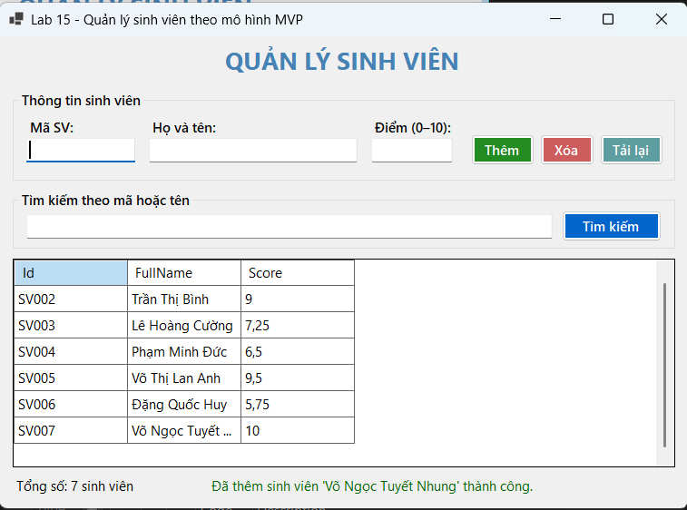 |
| TC03 | Thêm trùng mã | Mã `SV001` → Thêm | Báo lỗi trùng mã | 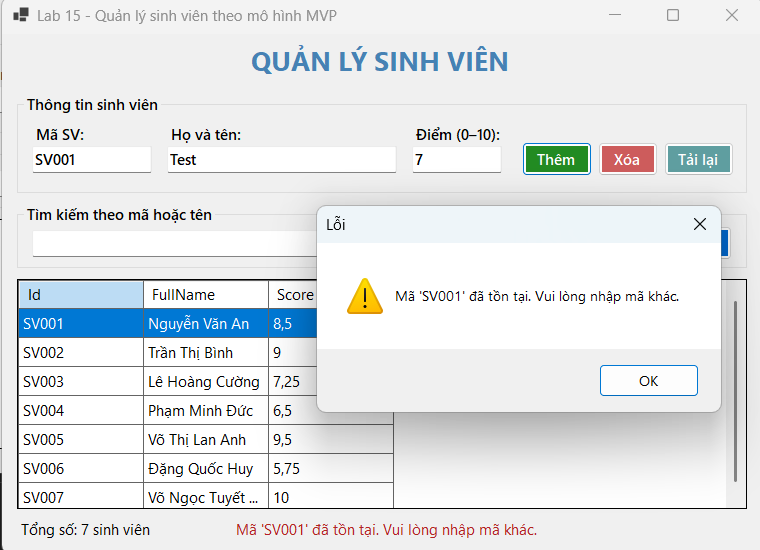 |
| TC04 | Xóa dữ liệu | Chọn `SV003` → Xóa → Có | Xóa thành công, lưới còn 6 dòng | 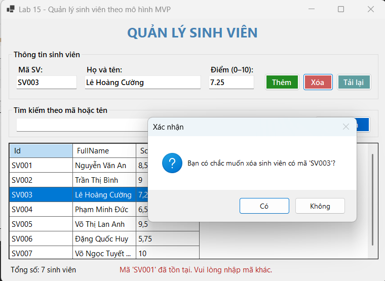 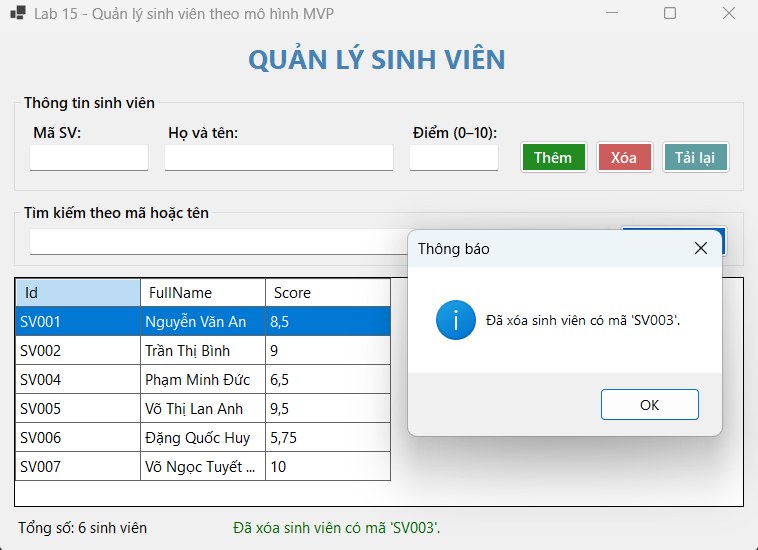 |
| TC05 | Tìm kiếm | Nhập `lan` → Tìm kiếm | Chỉ hiển thị Võ Thị Lan Anh | 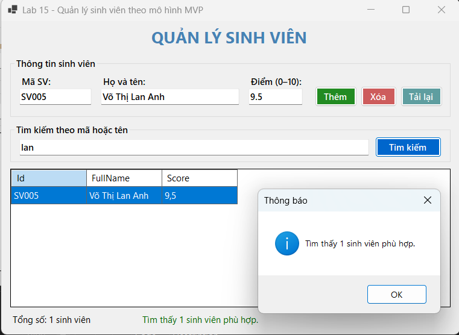 |
| TC06 | Dữ liệu rỗng | Để trống Họ tên → Thêm | Báo lỗi nhập đầy đủ | 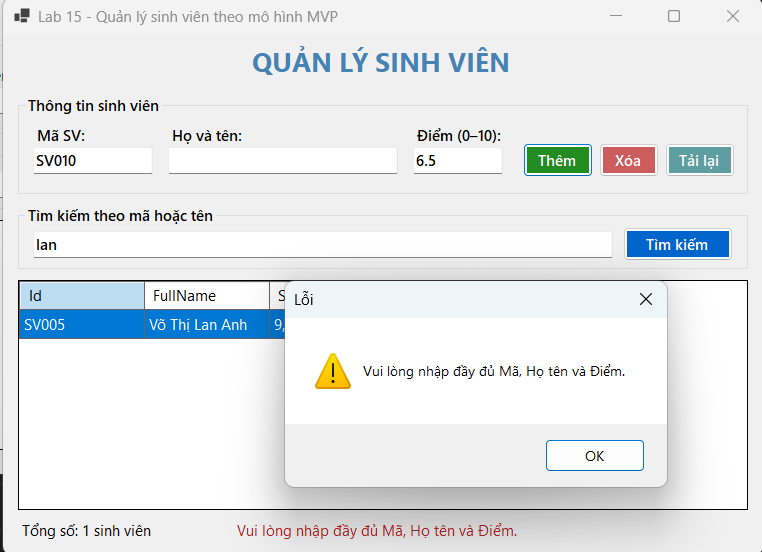 |
| TC07 | Sai kiểu dữ liệu | Điểm = `A` → Thêm | Báo lỗi điểm không hợp lệ | 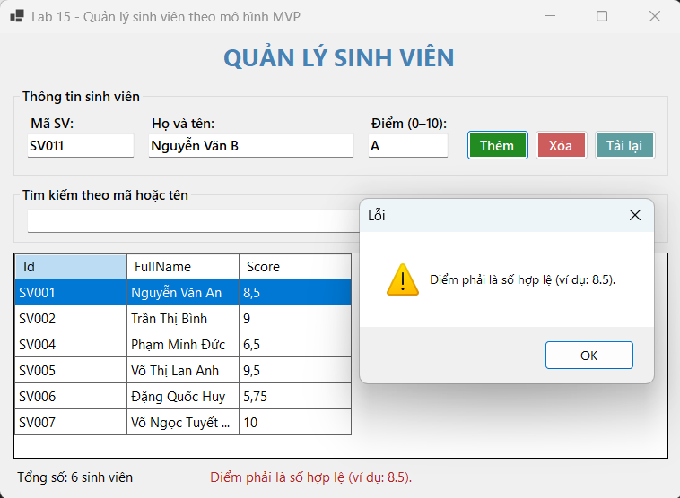 |
| TC08 | Điểm ngoài khoảng | Điểm = `11` → Thêm | Báo lỗi điểm từ 0 đến 10 | 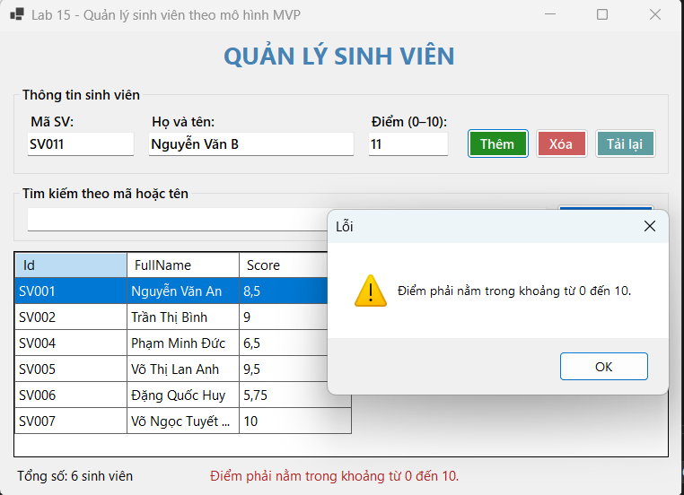 |
| TC09 | Tìm không có kết quả | Nhập `SV111` → Tìm kiếm | Thông báo không tìm thấy, lưới trống | 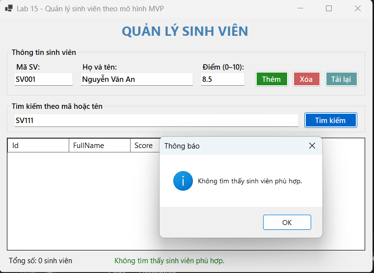 |

